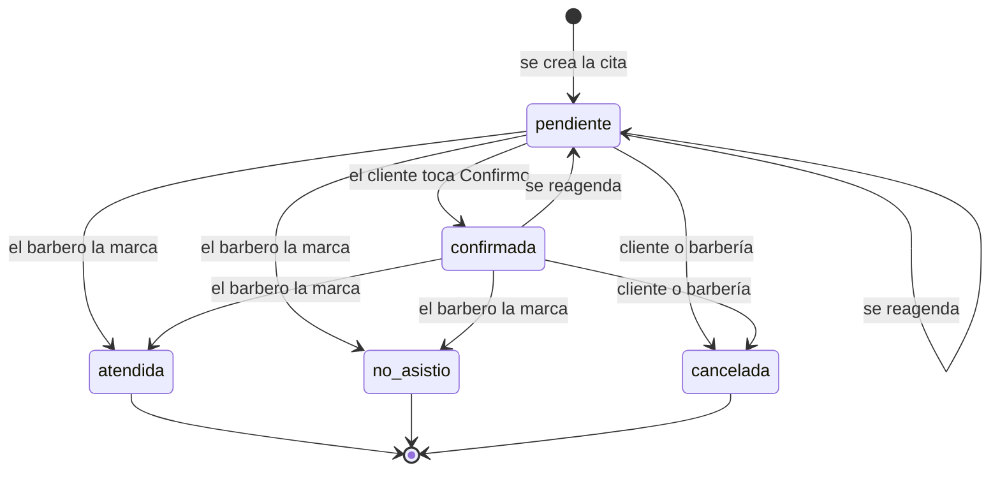

# 01 · Requerimientos

| | |
|---|---|
| **Versión del documento** | 0.1 (borrador) |
| **Fecha** | 7 de noviembre de 2026 |
| **Documentos relacionados** | [00 · Visión y alcance](00-vision-y-alcance.md), [04 · Modelo de datos](04-modelo-de-datos.md) |

---

## Convenciones

- **IDs:** `RF-xx` requerimiento funcional, `RNF-xx` no funcional, `RN-xx` regla de negocio. Los IDs no se reutilizan: si un requerimiento se elimina, se marca como *retirado*.
- **Prioridad (MoSCoW):** **M** = debe estar en el MVP · **S** = debería estar si alcanza el tiempo · **C** = podría estar, se puede posponer.
- **Trazabilidad:** cada caso de uso (doc 02), tarea y prueba debe citar los IDs que cubre.

---

## 1. Requerimientos funcionales

### A · Reserva pública (cliente)

| ID | Requerimiento | Prioridad |
|---|---|---|
| RF-01 | El sistema muestra una página pública por barbería, en una URL propia (`/b/{slug}`), con nombre, dirección y servicios activos con su duración y precio. | M |
| RF-02 | El cliente selecciona un servicio. | M |
| RF-03 | El cliente selecciona un barbero que preste ese servicio, o la opción "El primero disponible" (RN-05). Cada barbero muestra su próximo turno. | M |
| RF-04 | El sistema muestra los días y horas disponibles según el horario del barbero, la duración del servicio, las citas existentes, los bloqueos y las reglas de anticipación (RN-03, RN-04). | M |
| RF-05 | El cliente confirma la reserva ingresando solo su nombre y su número de WhatsApp, sin crear cuenta. | M |
| RF-06 | Al reservar, el cliente acepta la política de tratamiento de datos. El sistema guarda la autorización con fecha y versión del texto. | M |
| RF-07 | El formulario incluye una casilla opcional, **desmarcada por defecto**, para recibir avisos de "próximo corte". El sistema guarda la decisión. | S |
| RF-08 | Tras reservar, el sistema muestra una confirmación con botones "Agregar a mi calendario" (archivo .ics) y "Cómo llegar" (enlace de mapa). | M |
| RF-09 | Si el dispositivo ya reservó antes en esa barbería, el sistema ofrece "Repetir mi último corte" y prellena nombre y teléfono. El dato se guarda **solo en el dispositivo** del cliente: nunca se muestra el historial de alguien a partir de un teléfono escrito. | S |

### B · Gestión de la cita por el cliente

| ID | Requerimiento | Prioridad |
|---|---|---|
| RF-10 | Cada cita tiene un enlace de gestión privado y no adivinable que permite verla sin iniciar sesión. | M |
| RF-11 | Desde el enlace, el cliente cancela la cita, respetando el límite de cancelación (RN-06). | M |
| RF-12 | Desde el enlace, el cliente reagenda a otro turno disponible con el mismo barbero y servicio (RN-08). | M |

### C · Notificaciones por WhatsApp

| ID | Requerimiento | Prioridad |
|---|---|---|
| RF-13 | Al crear una cita, el sistema envía al cliente una confirmación con fecha, hora, barbero, dirección y el enlace de gestión. | M |
| RF-14 | El sistema envía un recordatorio el día anterior con botones "Confirmo", "Reagendar" y "Cancelar", cuando aplica según RN-07. | M |
| RF-15 | El sistema envía un recordatorio 2 horas antes con la hora y el enlace de "Cómo llegar", cuando aplica según RN-07. | M |
| RF-16 | El sistema procesa las respuestas a los botones y actualiza la cita: "Confirmo" la confirma, "Cancelar" la cancela, "Reagendar" responde con el enlace de gestión. | M |
| RF-17 | El sistema registra el estado de cada mensaje (enviado, entregado, leído, fallido) a partir del webhook de WhatsApp. | M |
| RF-18 | El sistema avisa al barbero por WhatsApp cuando hay una reserva nueva, una cancelación o un cliente sin confirmar (RN-09). | M |
| RF-19 | El sistema envía al barbero un resumen de su día a la hora que tenga configurada. | S |
| RF-20 | Al cancelar o reagendar una cita, el sistema anula las notificaciones pendientes y programa las nuevas que correspondan. | M |
| RF-21 | Si el cliente escribe un mensaje libre al número central, el sistema responde automáticamente con su enlace de gestión y el contacto de la barbería (enlace wa.me). | S |

### D · Panel del barbero

| ID | Requerimiento | Prioridad |
|---|---|---|
| RF-22 | El personal inicia sesión sin contraseña, con un enlace o código enviado a su correo. | M |
| RF-23 | El barbero ve la agenda del día: citas en orden, estado de cada una, huecos libres y una línea con la hora actual. | M |
| RF-24 | El barbero navega entre días (anterior y siguiente). | M |
| RF-25 | El barbero ve una vista semanal resumida. | S |
| RF-26 | El barbero ve el detalle de una cita: datos del cliente, número de visitas, fecha del último corte, historial de avisos y botones para escribirle (wa.me) o llamarlo. | M |
| RF-27 | El barbero cambia el estado de una cita: atendida, no vino, cancelada o reagendada (RN-08). | M |
| RF-28 | El barbero crea una cita manual para un cliente que llamó o llegó sin reserva. | M |
| RF-29 | El barbero bloquea rangos de su agenda (almuerzo, permiso, vacaciones). | M |
| RF-30 | La agenda se actualiza en tiempo real cuando entra o cambia una cita, sin recargar. | S |
| RF-31 | El panel se puede instalar como aplicación en el celular (PWA). | S |

### E · Administración de la barbería (dueño)

| ID | Requerimiento | Prioridad |
|---|---|---|
| RF-32 | El dueño edita los datos de la barbería: nombre, dirección, enlace de mapa, URL pública y logo. | M |
| RF-33 | El dueño gestiona los servicios: nombre, duración, precio, orden y estado activo. | M |
| RF-34 | El dueño invita y desactiva miembros, define su rol y qué servicios presta cada barbero. | M |
| RF-35 | El dueño configura el horario semanal de cada barbero, con varias franjas por día. | M |
| RF-36 | El dueño configura las reglas de reserva: intervalo de la grilla, anticipación mínima, ventana máxima, límite de cancelación y máximo de citas futuras por cliente. | M |
| RF-37 | El dueño ve la agenda de todos los barberos y puede filtrar por barbero. | M |
| RF-38 | El dueño ve la lista de clientes con su historial de citas. | S |
| RF-39 | El dueño ve un reporte por periodo: citas, cancelaciones e inasistencias por barbero. | C |
| RF-40 | El dueño bloquea la barbería entera en una fecha (festivo, cierre). | M |

### F · Plataforma

| ID | Requerimiento | Prioridad |
|---|---|---|
| RF-41 | El administrador de la plataforma crea, activa y suspende barberías. Una barbería suspendida no recibe reservas. | M |
| RF-42 | El administrador de la plataforma consulta el registro de notificaciones y errores de cada barbería. | S |
| RF-43 | El sistema atiende solicitudes de supresión de datos de un cliente (anonimización), según la Ley 1581. | M |

---

## 2. Requerimientos no funcionales

| ID | Categoría | Requerimiento |
|---|---|---|
| RNF-01 | Usabilidad | La reserva se completa en máximo 4 pantallas y la mediana de tiempo es menor a 60 segundos en celular. |
| RNF-02 | Usabilidad | Diseño mobile-first que funciona desde 360 px de ancho. Objetivos táctiles de al menos 44 px. |
| RNF-03 | Accesibilidad | Cumplir lo básico de WCAG 2.1 AA: contraste 4.5:1 en texto, controles reales (botones, etiquetas en campos) y navegación con teclado. |
| RNF-04 | Rendimiento | La página pública de reserva carga en menos de 3 s en una conexión 4G. El cálculo de disponibilidad responde en menos de 500 ms. |
| RNF-05 | Consistencia | Es imposible guardar dos citas activas que se crucen para el mismo barbero, aunque lleguen al mismo tiempo. Se garantiza con una restricción en la base de datos, no solo en el código. |
| RNF-06 | Puntualidad | Cada notificación sale dentro de los 5 minutos siguientes a su hora programada. |
| RNF-07 | Fiabilidad | El envío de notificaciones es idempotente: un mensaje nunca se envía dos veces. Los eventos del webhook repetidos se descartan. |
| RNF-08 | Seguridad | Los datos de cada barbería están aislados (RLS). Ningún usuario ve datos de otra barbería. |
| RNF-09 | Seguridad | Se valida la firma de cada webhook de Meta. Los secretos (tokens, claves) no están en el código fuente. |
| RNF-10 | Seguridad | El enlace de gestión usa un token aleatorio de al menos 128 bits; en la base de datos solo se guarda su hash. |
| RNF-11 | Privacidad | Cumplimiento de la Ley 1581 de 2012: política publicada, autorización registrada, supresión atendida y eventos crudos de WhatsApp borrados a los 90 días. |
| RNF-12 | Tiempo | Todas las fechas se guardan en UTC (`timestamptz`) y se muestran en la zona horaria de la barbería (`America/Bogota` por defecto). |
| RNF-13 | Localización | Interfaz en español de Colombia: horas como "5:15 p. m.", fechas como "sábado 7 de noviembre", precios como "$35.000". |
| RNF-14 | Disponibilidad | Disponibilidad mensual de al menos 99 % durante el piloto. |
| RNF-15 | Costo | La operación mensual del piloto no supera el presupuesto definido en P-06. |
| RNF-16 | Mantenibilidad | Cambios en la base de datos solo por migraciones versionadas. Las reglas críticas (disponibilidad, solapes, programación de notificaciones) tienen pruebas automáticas. |
| RNF-17 | Observabilidad | Toda notificación fallida queda registrada con su código de error y es visible para el barbero en el detalle de la cita. |

---

## 3. Reglas de negocio

### RN-01 · Composición de una cita
Una cita pertenece a una barbería, un barbero, un servicio y un cliente. Su duración es la del servicio en el momento de reservar.

### RN-02 · Sin solapes
Un barbero no puede tener dos citas no canceladas cuyos rangos de tiempo se crucen. Un horario tampoco se ofrece si se cruza con un bloqueo del barbero o de la barbería.

### RN-03 · Grilla de turnos
- Los turnos se generan cada *N* minutos (por defecto 15) desde el inicio de cada franja del horario.
- Un turno se ofrece solo si la duración completa del servicio cabe antes del fin de la franja.
- Ejemplo: franja de 14:00 a 19:00 y servicio de 45 min → el último turno ofrecido es 18:15.

### RN-04 · Anticipación y ventana
- Anticipación mínima para reservar: 60 minutos (configurable).
- Ventana máxima: 30 días hacia adelante (configurable).

### RN-05 · "El primero disponible"
Se asigna el barbero que presta el servicio y tiene el turno libre más cercano. Si hay empate, el que tenga menos citas ese día; si sigue el empate, el de menor `orden`.

### RN-06 · Cancelación por el cliente
- El cliente puede cancelar desde el enlace o desde el botón de WhatsApp hasta 120 minutos antes del inicio (configurable).
- Después de ese límite, el enlace muestra el contacto de la barbería en lugar del botón de cancelar.
- La barbería puede cancelar en cualquier momento.

### RN-07 · Programación de notificaciones al cliente

| Notificación | Cuándo se envía | Condición |
|---|---|---|
| Confirmación | Inmediatamente al crear la cita. | Siempre. |
| Recordatorio del día anterior (con botones) | 24 h antes del inicio. | Solo si faltan más de 26 h al crear la cita. |
| Recordatorio de 2 horas antes | 2 h antes del inicio. | Solo si faltan más de 3 h al crear la cita. Si no hubo recordatorio del día anterior, este lleva los botones. |

- **Horario silencioso:** no se envían recordatorios entre las 9:00 p. m. y las 7:00 a. m. (hora de la barbería). Si el de 2 horas antes cae en ese rango, se omite.
- Al reagendar se recalcula todo como si la cita se creara en ese momento, sin repetir la confirmación (se envía un aviso de cambio).

### RN-08 · Estados de una cita

- **Reagendar** modifica la misma cita (mantiene su ID y su enlace de gestión), la devuelve a `pendiente` y deja constancia en el historial.
- **No vino** solo se puede marcar después de la hora de inicio.
- **Atendida** y **no vino** son estados finales; el dueño puede corregirlos dentro de las 24 h siguientes.
- Una cita cancelada no se puede reactivar: se crea una nueva.

### RN-09 · Cliente sin confirmar
Si 60 minutos antes del inicio la cita sigue `pendiente` y ya se envió al menos un recordatorio con botones, el sistema avisa al barbero. **La cita no se cancela automáticamente.**

### RN-10 · Identidad del cliente
- Un cliente se identifica por la pareja (barbería, teléfono en formato E.164, por ejemplo `+573001234567`).
- El mismo número en dos barberías corresponde a dos clientes distintos: los datos no se comparten.
- Si el cliente reserva con un nombre distinto, se actualiza al último usado.

### RN-11 · Límites contra abuso
- Máximo 2 citas futuras activas por cliente en la misma barbería (configurable).
- Máximo 5 reservas por dirección IP por hora en la página pública.

### RN-12 · Mensajes de marketing
Los avisos de "próximo corte" (fase 2) solo se envían a clientes con consentimiento de marketing vigente. El cliente puede retirarlo en cualquier momento.

### RN-13 · Copia del servicio
Al crear una cita se copian el nombre, la duración y el precio del servicio. Si después el dueño cambia el servicio, las citas existentes no se modifican.

### RN-14 · Barbero desactivado
Un barbero desactivado deja de aparecer en la reserva pública. Sus citas futuras quedan señaladas en la agenda del dueño para que las reasigne o cancele.

### RN-15 · Respuestas tardías
Si llega la respuesta a un botón de una cita ya cancelada, atendida o pasada, no se modifica la cita y se le responde al cliente con un mensaje informativo.

### RN-16 · Barbería suspendida
Una barbería suspendida no muestra su página pública ni acepta reservas. Las citas existentes y sus recordatorios se mantienen.

### RN-17 · Citas manuales
- En una cita creada desde el panel, el teléfono del cliente es opcional (por ejemplo, alguien que llega sin reserva).
- Si se registra el teléfono, el barbero debe marcar que el cliente autorizó el tratamiento de sus datos y los avisos por WhatsApp. Esa autorización se guarda con origen `manual`.
- Sin teléfono o sin esa autorización, el sistema no le envía mensajes de WhatsApp a ese cliente.

### RN-18 · Reagendar desde el panel
El barbero o el dueño pueden reagendar sin límite de tiempo. Solo el dueño puede pasar una cita a otro barbero. Al hacerlo, el cliente recibe un aviso de cambio.

---

## 4. Criterios de aceptación de los requerimientos críticos

**RF-04 / RN-03 · Disponibilidad**
- *Dado* un barbero con horario de 14:00 a 19:00 y una cita de 15:00 a 15:45, *cuando* el cliente busca un servicio de 45 min con grilla de 15, *entonces* ve 14:00, 14:15 y todos los turnos desde 15:45 hasta 18:15, y no ve ningún turno entre 14:30 y 15:30 (todos se cruzarían con la cita).

**RF-05 / RNF-05 · Reserva concurrente**
- *Dado* un turno libre, *cuando* dos clientes intentan reservarlo al mismo tiempo, *entonces* solo una reserva se guarda y el otro cliente ve "Ese horario se acaba de ocupar" con los turnos actualizados.

**RF-14 / RN-07 · Recordatorio del día anterior**
- *Dada* una cita creada el jueves a las 6:40 p. m. para el sábado a las 5:15 p. m., *entonces* se programan la confirmación (inmediata), el recordatorio del viernes a las 5:15 p. m. y el de 2 horas antes del sábado a las 3:15 p. m.
- *Dada* una cita creada hoy a la 1:00 p. m. para las 5:15 p. m., *entonces* solo se programan la confirmación y el recordatorio de las 3:15 p. m., y este último lleva los botones.

**RF-16 · Respuesta a botón**
- *Dado* que el cliente toca "Cancelar" antes del límite de cancelación, *entonces* la cita pasa a `cancelada`, se anulan sus notificaciones pendientes, se libera el turno y el barbero recibe el aviso.
- *Dado* que el mismo evento del webhook llega dos veces, *entonces* se procesa una sola vez.

**RF-20 · Reagendar**
- *Dada* una cita con recordatorios pendientes, *cuando* el cliente la reagenda, *entonces* los recordatorios anteriores quedan `anulada` y se programan los nuevos según RN-07.
