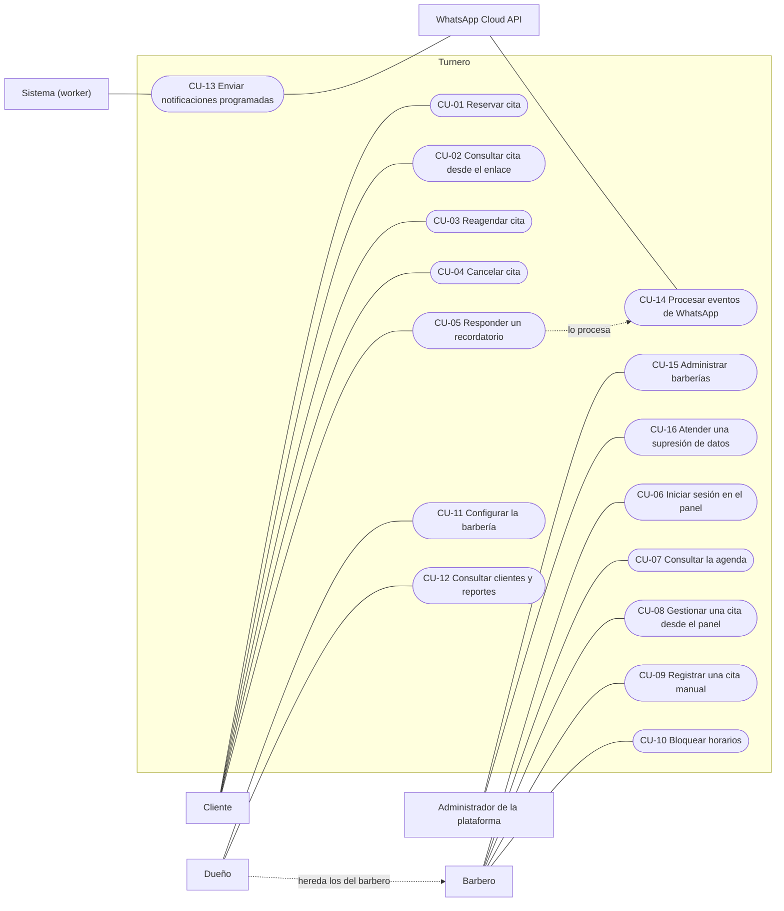

# 02 · Casos de uso

| | |
|---|---|
| **Versión del documento** | 0.1 (borrador) |
| **Fecha** | 7 de noviembre de 2026 |
| **Documentos relacionados** | [01 · Requerimientos](01-requerimientos.md), [03 · Arquitectura](03-arquitectura.md), [04 · Modelo de datos](04-modelo-de-datos.md) |

---

## Convenciones

- Cada caso de uso tiene un ID `CU-xx` y cita los requerimientos (`RF`) y reglas (`RN`) que cubre.
- Los flujos alternos se numeran con el paso del flujo principal donde ocurren: `5a` es una alternativa al paso 5.
- Los casos marcados con ★ son críticos: deben tener pruebas automáticas de punta a punta (doc 07).

---

## 1. Actores

| Actor | Tipo | Descripción |
|---|---|---|
| Cliente | Principal | Reserva y gestiona sus citas, sin cuenta. |
| Barbero | Principal | Atiende citas y maneja su agenda desde el panel. |
| Dueño | Principal | Hace todo lo del barbero, más administrar la barbería. Hereda los casos de uso del barbero. |
| Administrador de la plataforma | Principal | Opera el SaaS. |
| Sistema (worker) | Interno | Proceso que envía las notificaciones programadas. |
| WhatsApp Cloud API (Meta) | Externo | Entrega los mensajes y notifica respuestas y estados por webhook. |

## 2. Diagrama de casos de uso

## 3. Resumen

| ID | Caso de uso | Actor | Prioridad |
|---|---|---|---|
| CU-01 ★ | Reservar cita | Cliente | M |
| CU-02 | Consultar cita desde el enlace | Cliente | M |
| CU-03 ★ | Reagendar cita | Cliente | M |
| CU-04 ★ | Cancelar cita | Cliente | M |
| CU-05 ★ | Responder un recordatorio | Cliente | M |
| CU-06 | Iniciar sesión en el panel | Barbero, Dueño | M |
| CU-07 | Consultar la agenda | Barbero, Dueño | M |
| CU-08 ★ | Gestionar una cita desde el panel | Barbero, Dueño | M |
| CU-09 | Registrar una cita manual | Barbero, Dueño | M |
| CU-10 | Bloquear horarios | Barbero, Dueño | M |
| CU-11 | Configurar la barbería | Dueño | M |
| CU-12 | Consultar clientes y reportes | Dueño | S |
| CU-13 ★ | Enviar notificaciones programadas | Sistema | M |
| CU-14 ★ | Procesar eventos de WhatsApp | Sistema | M |
| CU-15 | Administrar barberías | Administrador | M |
| CU-16 | Atender una supresión de datos | Administrador | M |

---

## 4. Especificaciones

### CU-01 ★ · Reservar cita

| | |
|---|---|
| **Actor** | Cliente |
| **Objetivo** | Reservar un servicio con un barbero en menos de un minuto, sin crear cuenta. |
| **Cubre** | RF-01 a RF-09, RN-02 a RN-05, RN-10, RN-11, RN-13 |
| **Precondiciones** | La barbería está activa y tiene al menos un servicio activo y un barbero con horario. |
| **Disparador** | El cliente abre el enlace público de la barbería (`/b/{slug}`). |

**Flujo principal**
1. El sistema muestra el nombre, la dirección y los servicios activos con su duración y precio.
2. El cliente elige un servicio.
3. El sistema muestra los barberos que prestan ese servicio, cada uno con su próximo turno, y la opción "El primero disponible".
4. El cliente elige un barbero.
5. El sistema muestra los próximos días y los turnos libres del día seleccionado, agrupados en mañana, tarde y noche.
6. El cliente elige un turno.
7. El sistema muestra el resumen (servicio, barbero, fecha y hora, dirección, precio) y pide nombre y WhatsApp, junto con la aceptación de la política de datos y la casilla opcional de "próximo corte".
8. El cliente completa los datos y toca "Confirmar reserva".
9. El sistema valida de nuevo el turno, registra o actualiza al cliente, crea la cita, guarda los consentimientos, programa las notificaciones (RN-07) y le avisa al barbero.
10. El sistema muestra la confirmación con "Agregar a mi calendario" y "Cómo llegar", y guarda en el dispositivo el nombre, el teléfono y el último servicio.

**Flujos alternos**
- **2a.** El dispositivo ya reservó antes en esta barbería: el sistema ofrece "Repetir mi último corte". Si el cliente lo elige, pasa al paso 5 con servicio y barbero preseleccionados.
- **4a.** El cliente elige "El primero disponible": en el paso 6 el sistema asigna el barbero según RN-05 y lo muestra en el resumen.
- **5a.** No hay turnos dentro de la ventana de reserva: el sistema lo informa y muestra el contacto de la barbería.
- **8a.** El teléfono no es válido: el sistema muestra el error junto al campo y no avanza.
- **9a.** El turno se ocupó mientras el cliente llenaba los datos: el sistema muestra "Ese horario se acaba de ocupar" y vuelve al paso 5 con los turnos actualizados, sin borrar nombre ni teléfono.
- **9b.** El cliente ya tiene el máximo de citas futuras (RN-11): el sistema indica cuántas tiene y le pide revisar su WhatsApp para gestionarlas. **No muestra los detalles**, porque cualquiera puede escribir un teléfono ajeno.
- **9c.** Se superó el límite de reservas por IP: el sistema pide intentar más tarde.
- **1a.** La barbería no existe o está suspendida (RN-16): el sistema muestra una página de "no disponible".

**Postcondiciones:** la cita queda `pendiente`, con sus notificaciones programadas, el evento `creada` en el historial y el barbero avisado.

---

### CU-02 · Consultar cita desde el enlace

| | |
|---|---|
| **Actor** | Cliente |
| **Cubre** | RF-10 |
| **Disparador** | El cliente abre el enlace de gestión que recibió por WhatsApp o en la confirmación. |

**Flujo principal**
1. El sistema busca la cita por el hash del token y muestra servicio, barbero, fecha y hora, dirección, precio y estado.
2. Según el estado y el límite de cancelación, muestra los botones "Cambiar hora", "Cancelar", "Agregar a mi calendario" y "Cómo llegar".

**Flujos alternos**
- **1a.** El token no existe: el sistema muestra "Este enlace no es válido" sin dar más detalles.
- **2a.** La cita está cancelada, atendida o ya pasó: el sistema la muestra en modo lectura con el botón "Reservar otra cita".

---

### CU-03 ★ · Reagendar cita

| | |
|---|---|
| **Actor** | Cliente |
| **Cubre** | RF-12, RF-20, RN-06, RN-07, RN-08 |
| **Precondiciones** | La cita está `pendiente` o `confirmada`, es futura y no ha pasado el límite de cancelación. |
| **Disparador** | El cliente toca "Cambiar hora" en el enlace de gestión (CU-02), o "Reagendar" en WhatsApp (CU-05). |

**Flujo principal**
1. El sistema muestra los turnos libres del mismo barbero para el mismo servicio, sin contar la propia cita como ocupada.
2. El cliente elige un nuevo turno y confirma.
3. El sistema actualiza la misma cita (conserva su ID y su enlace), la devuelve a `pendiente` y registra el evento `reagendada` con la hora anterior y la nueva.
4. El sistema anula las notificaciones pendientes, programa las nuevas según RN-07 (con un aviso de cambio en lugar de la confirmación) y le avisa al barbero.
5. El sistema muestra la cita actualizada.

**Flujos alternos**
- **P1.** Ya pasó el límite de cancelación: el enlace no muestra "Cambiar hora", sino un botón para escribirle a la barbería (wa.me).
- **2a.** El turno se ocupó en ese momento: el sistema avisa y vuelve al paso 1.

**Postcondiciones:** la cita tiene la nueva hora, notificaciones recalculadas y el barbero avisado.

---

### CU-04 ★ · Cancelar cita

| | |
|---|---|
| **Actor** | Cliente |
| **Cubre** | RF-11, RF-20, RN-06 |
| **Precondiciones** | La cita está `pendiente` o `confirmada` y no ha pasado el límite de cancelación. |
| **Disparador** | El cliente toca "Cancelar" en el enlace de gestión. |

**Flujo principal**
1. El sistema pide confirmar: "¿Seguro que quieres cancelar tu cita del sábado 7 de noviembre a las 5:15 p. m.?".
2. El cliente confirma.
3. El sistema pasa la cita a `cancelada` (cancelada por el cliente), anula sus notificaciones pendientes, registra el evento y le avisa al barbero.
4. El sistema muestra "Tu cita fue cancelada" con el botón "Reservar otra cita".

**Flujos alternos**
- **P1.** Ya pasó el límite: el enlace muestra el contacto de la barbería en lugar de "Cancelar".

**Postcondiciones:** el turno queda libre para otros clientes.

---

### CU-05 ★ · Responder un recordatorio

| | |
|---|---|
| **Actor** | Cliente (por WhatsApp) |
| **Cubre** | RF-14, RF-16, RF-21, RN-06, RN-08, RN-15 |
| **Precondiciones** | El cliente recibió un recordatorio con botones (CU-13). |
| **Disparador** | El cliente toca un botón del recordatorio. Meta envía el evento al webhook y se procesa en CU-14. |

**Flujo principal (toca "Confirmo")**
1. El sistema pasa la cita a `confirmada`, guarda la hora de confirmación y registra el evento.
2. El sistema responde: "Listo, [nombre]. Te esperamos [cuándo]."

**Flujos alternos**
- **A. Toca "Cancelar":** si está dentro del límite, el sistema ejecuta los pasos 3 de CU-04 y responde con un enlace para reservar otra cita. Si ya pasó el límite, responde con el contacto de la barbería.
- **B. Toca "Reagendar":** el sistema responde con el enlace de gestión para continuar en CU-03.
- **C. La cita ya no admite cambios** (cancelada, atendida o pasada): no se modifica nada y el sistema responde con un mensaje informativo (RN-15).
- **D. El cliente escribe un mensaje libre:** el sistema responde con su enlace de gestión, si tiene una cita activa, y con el contacto de la barbería (RF-21).

---

### CU-06 · Iniciar sesión en el panel

| | |
|---|---|
| **Actor** | Barbero, Dueño |
| **Cubre** | RF-22, RF-31 |
| **Precondiciones** | El dueño (o el administrador, para el primer dueño) registró al miembro con su correo (CU-11). |

**Flujo principal**
1. El miembro abre el panel y escribe su correo.
2. El sistema envía un enlace o código de acceso a ese correo.
3. El miembro abre el enlace o escribe el código.
4. El sistema crea la sesión. Si es el primer ingreso, vincula el usuario con su registro de miembro.
5. El sistema abre la agenda (CU-07) y, en el celular, ofrece instalar el panel como aplicación.

**Flujos alternos**
- **2a.** El correo no corresponde a ningún miembro activo: el sistema muestra el mismo mensaje que en el caso normal ("Si el correo está registrado, te llegará un enlace"), para no revelar qué correos existen.
- **3a.** El enlace venció: el sistema permite pedir otro.

---

### CU-07 · Consultar la agenda

| | |
|---|---|
| **Actor** | Barbero, Dueño |
| **Cubre** | RF-23 a RF-25, RF-30, RF-37 |
| **Precondiciones** | Sesión iniciada. |

**Flujo principal**
1. El sistema muestra la agenda de hoy del barbero: el resumen (citas, confirmadas, sin confirmar), las citas en orden con su estado, los huecos libres y la línea de la hora actual.
2. El barbero navega a otro día con las flechas o cambia a la vista semanal.
3. Si entra o cambia una cita mientras la agenda está abierta, el sistema la actualiza sin recargar.
4. El barbero toca una cita para ver su detalle (CU-08) o un hueco libre para crear una cita (CU-09).

**Flujos alternos**
- **1a.** Es el dueño: puede elegir un barbero o ver la agenda de todos.
- **1b.** El barbero no trabaja ese día: el sistema muestra "No tienes horario este día".
- **1c.** Hay citas de un barbero desactivado (RN-14): el dueño las ve señaladas para reasignarlas o cancelarlas.

---

### CU-08 ★ · Gestionar una cita desde el panel

| | |
|---|---|
| **Actor** | Barbero, Dueño |
| **Cubre** | RF-20, RF-26, RF-27, RN-08, RN-14, RN-18 |
| **Precondiciones** | Sesión iniciada; la cita es del barbero (o el actor es el dueño). |
| **Disparador** | El actor abre el detalle de una cita desde la agenda o desde un aviso de WhatsApp. |

**Flujo principal**
1. El sistema muestra el detalle: estado, hora, servicio y precio; nombre y teléfono del cliente, número de visitas y fecha del último corte; el historial de avisos con su estado de entrega.
2. El actor elige una acción:
   - **Marcar como atendida.**
   - **No vino:** solo disponible después de la hora de inicio.
   - **Reagendar:** elige un nuevo turno, sin límite de tiempo (RN-18).
   - **Cancelar:** con un motivo opcional.
   - **WhatsApp / Llamar:** abre el WhatsApp o el teléfono del propio barbero con el número del cliente.
3. El sistema aplica el cambio de estado (RN-08), registra el evento con el actor y actualiza la agenda.
4. Si la acción fue reagendar o cancelar, el sistema anula y reprograma las notificaciones y le envía un aviso al cliente.

**Flujos alternos**
- **2a.** El dueño reasigna la cita a otro barbero: el sistema valida la disponibilidad del nuevo barbero y le avisa a ambos y al cliente.
- **2b.** El dueño corrige un estado final (atendida o no vino) dentro de las 24 horas siguientes.
- **2c.** El cliente no tiene teléfono: los botones de WhatsApp y Llamar no aparecen.
- **3a.** El nuevo turno se cruza con otra cita: el sistema lo impide y muestra el conflicto.

---

### CU-09 · Registrar una cita manual

| | |
|---|---|
| **Actor** | Barbero, Dueño |
| **Cubre** | RF-28, RN-02, RN-17 |
| **Disparador** | El actor toca "+" o un hueco libre en la agenda. |

**Flujo principal**
1. El actor elige el servicio; el sistema propone la duración.
2. El actor busca al cliente por nombre o teléfono, o escribe uno nuevo (el teléfono es opcional).
3. Si escribe un teléfono, marca la casilla "El cliente autorizó el uso de sus datos y los avisos por WhatsApp".
4. El actor elige la hora (por defecto, la del hueco que tocó) y guarda.
5. El sistema crea la cita con origen `manual`. Si hay teléfono y autorización, registra el consentimiento y programa las notificaciones.

**Flujos alternos**
- **2a.** El teléfono ya existe en la barbería: el sistema usa ese cliente y muestra su nombre.
- **3a.** No se marca la autorización: la cita se guarda, pero sin mensajes de WhatsApp al cliente.
- **4a.** La hora se cruza con otra cita: el sistema lo impide.
- **4b.** La hora está fuera del horario del barbero: el sistema advierte, pero permite guardar (el barbero decide atender fuera de horario).

---

### CU-10 · Bloquear horarios

| | |
|---|---|
| **Actor** | Barbero (su agenda), Dueño (cualquier barbero o toda la barbería) |
| **Cubre** | RF-29, RF-40, RN-02 |

**Flujo principal**
1. El actor elige el rango (fecha, hora de inicio y fin, o días completos) y un motivo opcional.
2. El sistema crea el bloqueo; esos turnos dejan de ofrecerse en la reserva pública.

**Flujos alternos**
- **2a.** Hay citas dentro del rango: el sistema las lista y ofrece cancelarlas avisando a los clientes, o volver atrás para reagendarlas primero.

---

### CU-11 · Configurar la barbería

| | |
|---|---|
| **Actor** | Dueño |
| **Cubre** | RF-32 a RF-36, RN-14 |

**Subflujos**
- **Datos de la barbería:** nombre, dirección, enlace de mapa, URL pública (slug) y logo. Si cambia el slug, el enlace anterior deja de funcionar: el sistema lo advierte.
- **Servicios:** crear, editar, ordenar y desactivar. Un servicio desactivado no se ofrece, pero sus citas existentes no cambian (RN-13).
- **Miembros:** registrar con nombre, correo, WhatsApp y rol; elegir qué servicios presta; desactivar (RN-14).
- **Horarios:** varias franjas por día para cada barbero. El sistema rechaza franjas que se crucen.
- **Reglas de reserva:** intervalo de la grilla, anticipación mínima, ventana máxima, límite de cancelación y máximo de citas futuras por cliente.

**Postcondiciones:** los cambios se reflejan de inmediato en la página pública.

---

### CU-12 · Consultar clientes y reportes

| | |
|---|---|
| **Actor** | Dueño |
| **Cubre** | RF-38, RF-39 |

**Flujo principal**
1. El dueño abre "Clientes" y busca por nombre o teléfono.
2. El sistema muestra la lista con visitas, inasistencias y última visita.
3. Al abrir un cliente, ve su historial de citas y sus notas.
4. En "Reportes", elige un periodo y ve citas, cancelaciones e inasistencias por barbero.

---

### CU-13 ★ · Enviar notificaciones programadas

| | |
|---|---|
| **Actor** | Sistema (worker) |
| **Cubre** | RF-13 a RF-15, RF-17 a RF-19, RN-07, RN-09, RNF-06, RNF-07 |
| **Disparador** | El worker se ejecuta cada minuto. |

**Flujo principal**
1. El worker toma un lote de notificaciones vencidas, sin que otro proceso pueda tomar las mismas.
2. Para cada una, verifica que siga teniendo sentido:
   - Un recordatorio solo sale si la cita está `pendiente` o `confirmada`.
   - Un aviso de "sin confirmar" solo sale si la cita sigue `pendiente` y ya se envió un recordatorio con botones (RN-09).
   - Un recordatorio de 2 horas no sale en horario silencioso (RN-07).
3. Arma la plantilla con sus variables y la envía por la interfaz de notificaciones.
4. Guarda el ID del mensaje (`wamid`) y marca la notificación como `enviada`.
5. Cada día, a la hora configurada por cada barbero, programa su resumen diario.

**Flujos alternos**
- **2a.** La notificación ya no aplica: queda `anulada` con el motivo.
- **3a.** Error temporal (red, límite de velocidad): vuelve a `pendiente` unos minutos después, hasta 3 intentos.
- **3b.** Error permanente (por ejemplo, número sin WhatsApp): queda `fallida` con el código de error y el barbero lo ve en el detalle de la cita.
- **3c.** Se alcanzó el límite diario de mensajes de Meta: se reprograma y se alerta al administrador.

---

### CU-14 ★ · Procesar eventos de WhatsApp

| | |
|---|---|
| **Actor** | WhatsApp Cloud API (Meta) |
| **Cubre** | RF-16, RF-17, RF-21, RN-15, RNF-07, RNF-09 |
| **Disparador** | Meta envía un evento al webhook. |

**Flujo principal**
1. El sistema valida la firma del evento.
2. Guarda el evento crudo con su clave de deduplicación y responde `200` de inmediato.
3. Procesa el evento según su tipo:
   - **Estado de un mensaje** (enviado, entregado, leído, fallido): actualiza la notificación correspondiente.
   - **Respuesta a un botón:** obtiene la acción y la cita del *payload* y ejecuta CU-05.
   - **Mensaje libre:** ejecuta el flujo D de CU-05.
4. Marca el evento como procesado.

**Flujos alternos**
- **1a.** La firma no es válida: responde `401` y no guarda nada.
- **2a.** El evento ya se había recibido: responde `200` y no lo procesa otra vez.
- **3a.** El evento se refiere a una cita o notificación que no existe: se registra el error para revisión.

---

### CU-15 · Administrar barberías

| | |
|---|---|
| **Actor** | Administrador de la plataforma |
| **Cubre** | RF-41, RF-42, RN-16 |

**Flujo principal**
1. El administrador crea la barbería con su nombre, slug y dirección, y registra al primer dueño con su correo.
2. El dueño recibe el acceso (CU-06) y configura su barbería (CU-11).
3. El administrador puede suspender o reactivar una barbería y revisar su registro de notificaciones y errores.

---

### CU-16 · Atender una supresión de datos

| | |
|---|---|
| **Actor** | Administrador de la plataforma |
| **Cubre** | RF-43, RNF-11 |
| **Disparador** | Un cliente pide que se eliminen sus datos (por WhatsApp, correo o a través de la barbería). |

**Flujo principal**
1. El administrador verifica la identidad: la solicitud debe venir del mismo número de WhatsApp registrado.
2. Busca al cliente en la barbería correspondiente y ejecuta la anonimización.
3. Le confirma al cliente que sus datos fueron eliminados, dentro del plazo de la Ley 1581 (15 días hábiles para reclamos).

**Postcondiciones:** el cliente queda como "Cliente eliminado", sin nombre ni teléfono; sus citas se conservan solo para estadísticas.

---

## 5. Matriz de trazabilidad (RF → CU)

| RF | CU | | RF | CU |
|---|---|---|---|---|
| RF-01 a RF-09 | CU-01 | | RF-26, RF-27 | CU-08 |
| RF-10 | CU-02 | | RF-28 | CU-09 |
| RF-11 | CU-04, CU-05 | | RF-29 | CU-10 |
| RF-12 | CU-03 | | RF-30 | CU-07 |
| RF-13 | CU-13 | | RF-31 | CU-06 |
| RF-14 | CU-13, CU-05 | | RF-32 a RF-36 | CU-11 |
| RF-15 | CU-13 | | RF-37 | CU-07 |
| RF-16 | CU-05, CU-14 | | RF-38, RF-39 | CU-12 |
| RF-17 | CU-14 | | RF-40 | CU-10 |
| RF-18, RF-19 | CU-13 | | RF-41, RF-42 | CU-15 |
| RF-20 | CU-03, CU-04, CU-08 | | RF-43 | CU-16 |
| RF-21 | CU-05, CU-14 | | | |
| RF-22 | CU-06 | | | |
| RF-23 a RF-25 | CU-07 | | | |

Todos los requerimientos funcionales del 01 quedan cubiertos por al menos un caso de uso.
