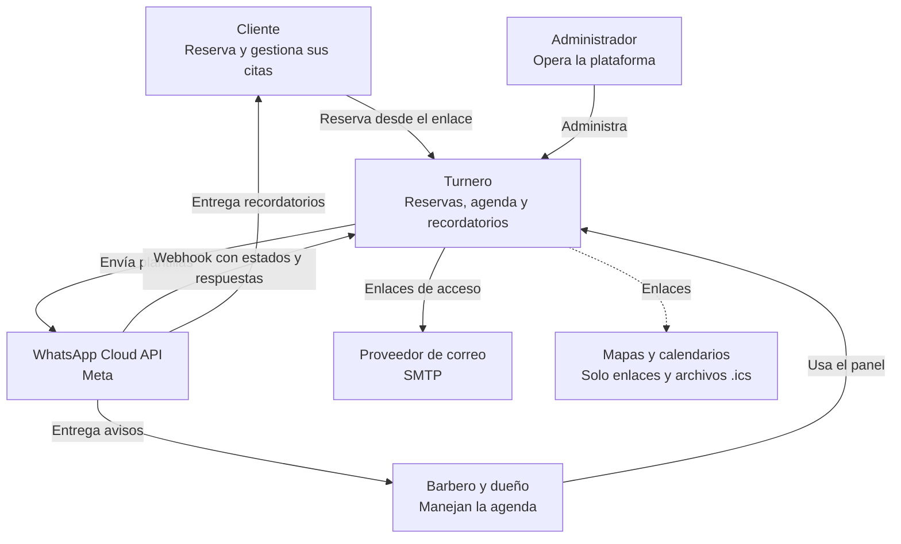
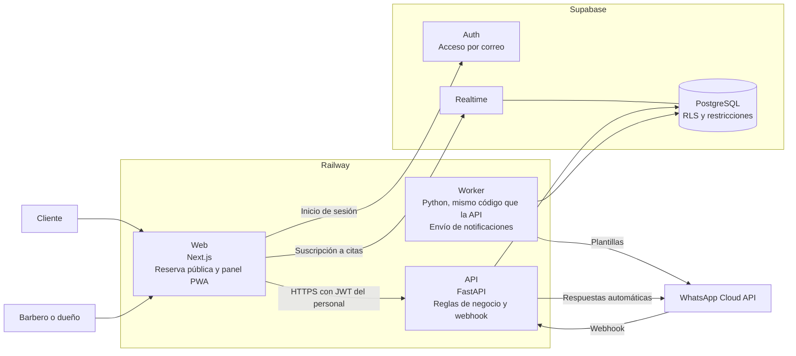
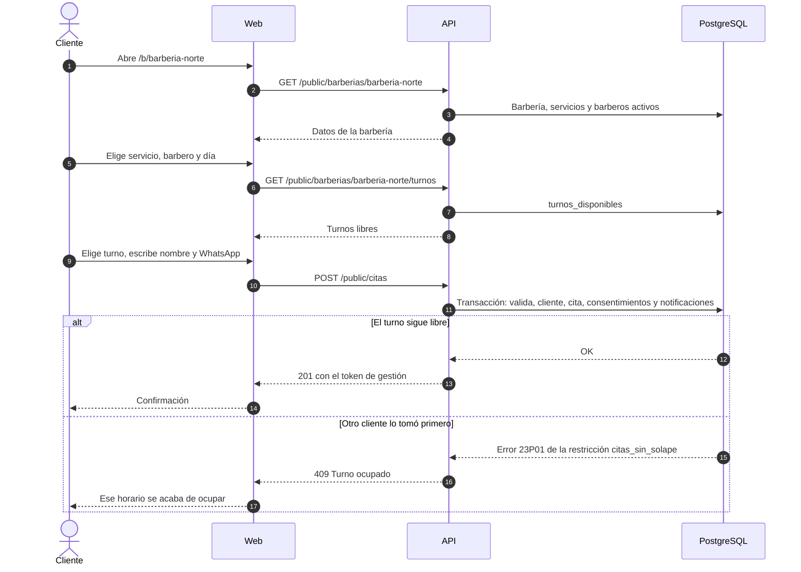
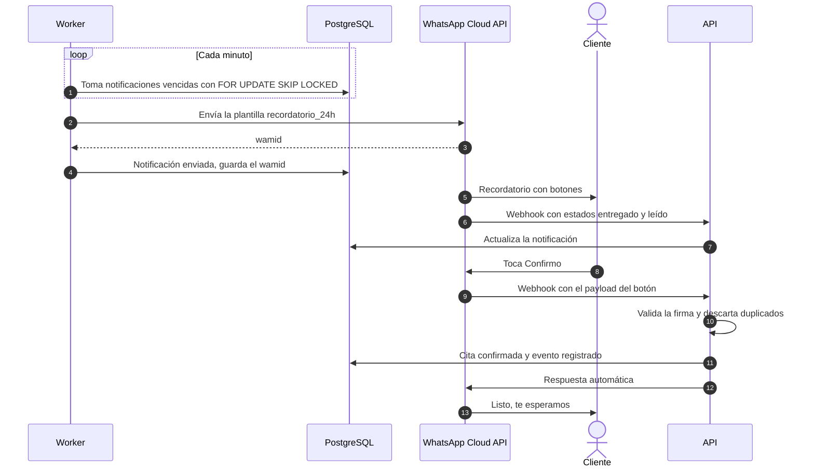
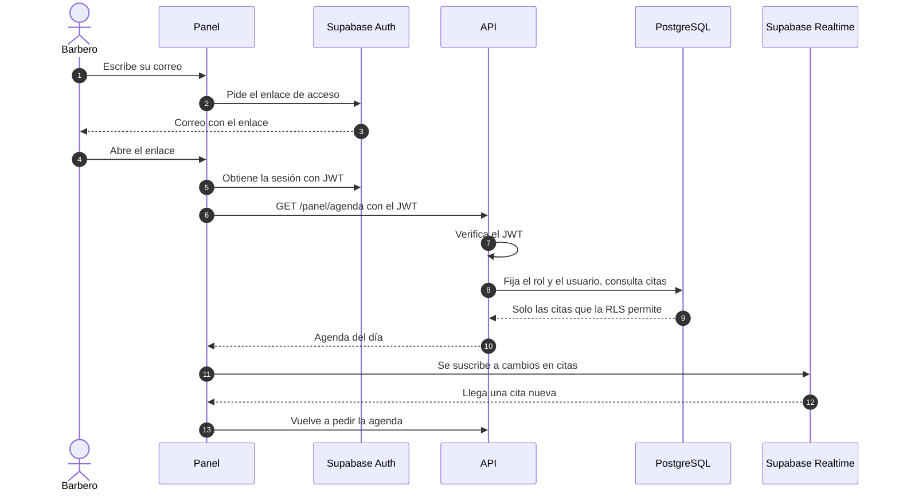

# 03 · Arquitectura

| | |
|---|---|
| **Versión del documento** | 0.1 (borrador) |
| **Fecha** | 7 de noviembre de 2026 |
| **Documentos relacionados** | [01 · Requerimientos](01-requerimientos.md), [02 · Casos de uso](02-casos-de-uso.md), [04 · Modelo de datos](04-modelo-de-datos.md), [11 · Dominios](11-dominios.md), [Decisiones (ADR)](adr/) |

---

## 1. Qué guía esta arquitectura

Los atributos de calidad que más pesan, en orden:

1. **Consistencia de la agenda:** nunca dos citas en el mismo turno (RNF-05). Se resuelve en la base de datos, no en el código.
2. **Recordatorios puntuales y sin duplicados** (RNF-06, RNF-07): bandeja de salida en la base y un worker idempotente.
3. **Aislamiento entre barberías** (RNF-08): RLS en la base, además de los filtros del backend.
4. **Simplicidad para un solo desarrollador:** pocas piezas, tecnologías que ya se dominan y nada que haya que operar a mano.
5. **Costo bajo** (RNF-15): servicios administrados con planes pequeños.

## 2. Stack

Propuesta formal en [ADR-0007](adr/0007-stack-nextjs-fastapi-railway.md). Cierra la decisión pendiente P-02 cuando se acepte.

| Capa | Tecnología | Por qué |
|---|---|---|
| Web (reserva pública y panel) | **Next.js** con TypeScript, como PWA | Un solo frontend para clientes y personal; experiencia previa. |
| API, webhook y worker | **FastAPI** (Python) | Experiencia previa; documentación OpenAPI automática; el worker comparte el mismo código. |
| Base de datos | **PostgreSQL en Supabase** | Restricciones de exclusión, RLS y migraciones. |
| Autenticación del personal | **Supabase Auth** (enlace o código por correo) | Sin contraseñas; no hay que construirlo. |
| Tiempo real | **Supabase Realtime** | Agenda que se actualiza sola, respetando la RLS. |
| Mensajería | **WhatsApp Cloud API** (Meta), número central | [ADR-0001](adr/0001-whatsapp-numero-central-api-oficial.md). |
| Hosting de web, API y worker | **Railway** (Docker) | Experiencia previa; permite uso comercial y procesos permanentes. |
| Correo de acceso | SMTP propio configurado en Supabase Auth | El correo integrado de Supabase es solo para pruebas. |
| Errores | Un servicio de seguimiento de errores con plan gratuito (por ejemplo, Sentry) | Enterarse de los fallos antes que el barbero. |

---

## 3. Contexto (C4, nivel 1)



## 4. Contenedores (C4, nivel 2)



| Contenedor | Responsabilidad | Se despliega como |
|---|---|---|
| **Web** | Páginas públicas (`/b/{slug}`, `/c/{token}`) y panel (`/panel`). No contiene reglas de negocio: todo pasa por la API. | Servicio de Railway |
| **API** | Disponibilidad, reservas, gestión de citas, panel, configuración, webhook de WhatsApp. | Servicio de Railway |
| **Worker** | Envía las notificaciones vencidas cada minuto, programa los resúmenes diarios y limpia datos viejos. | Servicio de Railway, mismo repositorio que la API |
| **PostgreSQL** | Fuente de verdad. Garantiza la no-superposición de citas y el aislamiento por barbería. | Supabase |
| **Auth / Realtime** | Sesión del personal y cambios en vivo de la agenda. | Supabase |

---

## 5. Dominios de la API

La API es un **monolito modular organizado por dominios** ([ADR-0009](adr/0009-monolito-modular-por-dominios.md)). Cada dominio solo depende de los que tiene debajo; los efectos hacia arriba van por eventos. El detalle está en [11 · Dominios](11-dominios.md).

| Dominio | Tipo | Responsabilidad | Casos de uso |
|---|---|---|---|
| `mensajeria` | Genérico | Integración con WhatsApp: envío, plantillas, webhook y traducción de los eventos de Meta. | CU-05, CU-14 |
| `notificaciones` | Soporte | Qué mensaje sale, a quién y cuándo (RN-07); bandeja de salida y worker. | CU-13 |
| `agenda` | **Núcleo** | Horarios, bloqueos, turnos libres y ciclo de vida de las citas. | CU-01 a CU-04, CU-07 a CU-10 |
| `clientes` | Soporte | Clientes, autorizaciones y anonimización. | CU-12, CU-16 |
| `barberias` | Soporte | Barbería, equipo, roles, servicios y reglas de reserva. | CU-06, CU-11, CU-15 |

Fuera de los dominios están `core/` (configuración, base de datos con contexto RLS, JWT, bus de eventos, errores, límites, logs) y `shared/` (tipos sin dominio, como el teléfono en E.164).

### 5.1 Interfaz de notificaciones ([ADR-0006](adr/0006-interfaz-propia-de-notificaciones.md))

```python
class ProveedorNotificaciones(Protocol):
    async def enviar_plantilla(
        self,
        telefono_e164: str,
        plantilla: str,
        idioma: str,
        variables: dict[str, str],
        payloads_botones: list[str] | None = None,
    ) -> ResultadoEnvio: ...
```

| Proveedor | Cuándo |
|---|---|
| `ConsolaProvider` | Desarrollo local: imprime el mensaje y un enlace wa.me para probar a mano. |
| `WhatsAppCloudProvider` | Pruebas con el número de prueba de Meta y producción. Vive en el dominio `mensajeria`, que implementa el puerto definido por `notificaciones`. |

El **programador** es una función pura, `programar(cita, ahora) -> list[NotificacionNueva]`, sin acceso a la base ni a la red. Así RN-07 se prueba con casos de tabla sin montar nada.

---

## 6. Flujos principales

### 6.1 Reservar una cita (CU-01)



### 6.2 Recordatorio y respuesta del cliente (CU-13, CU-14, CU-05)



### 6.3 Panel: acceso y agenda en vivo (CU-06, CU-07)



---

## 7. Seguridad

### 7.1 Tres formas de entrar, tres controles

| Entrada | Quién | Cómo se autoriza |
|---|---|---|
| **Pública** (`/public/*`) | Cualquiera | Sin sesión. La API usa la conexión de servicio y **siempre** filtra por la barbería del slug o del token. Límite de peticiones por IP (RN-11). |
| **Panel** (`/panel/*`, `/admin/*`) | Personal y administrador | La API verifica el JWT de Supabase y, en cada petición, abre una transacción con el rol `authenticated` y los datos del usuario. Así la **RLS de la base también aplica**, aunque el código tenga un error. |
| **Webhook** (`/webhooks/whatsapp`) | Meta | Firma `X-Hub-Signature-256` validada con el App Secret. Sin firma válida, `401`. |

Detalle de la entrada del panel ([ADR-0008](adr/0008-rls-por-peticion-en-el-panel.md)):

```python
async with pool.acquire() as con, con.transaction():
    await con.execute("set local role authenticated")
    await con.execute(
        "select set_config('request.jwt.claims', $1, true)",
        json.dumps(claims),  # claims del JWT ya verificado; auth.uid() lee el 'sub'
    )
    # ... consultas del panel: la RLS filtra por barbería y por barbero
```

`set local` y `set_config(..., true)` solo duran lo que dura la transacción, así que la conexión vuelve limpia al pool.

### 7.2 Otras medidas

- **Secretos** (token de Meta, App Secret, llaves de Supabase) solo en variables de entorno de Railway; nunca en el repositorio.
- **Enlace de gestión:** token aleatorio de 32 bytes; en la base solo su hash (DM-05).
- **CORS:** la API solo acepta peticiones del dominio de la web.
- **Validación de entrada** con modelos de Pydantic en todos los endpoints.
- **Datos personales:** los registros de logs no incluyen teléfonos completos (se enmascaran: `+57300***4567`).

---

## 8. Manejo del tiempo

- La base y la API trabajan en **UTC**. La API devuelve fechas en ISO 8601 con zona.
- La web formatea con la zona de la barbería (`America/Bogota` por defecto) y el formato `es-CO` ("5:15 p. m.").
- Los horarios semanales se guardan como hora local y se convierten a instantes solo al calcular turnos (DM-08).
- Colombia no tiene horario de verano, pero el código no lo asume: siempre convierte con la zona de la barbería.

---

## 9. API: endpoints principales

FastAPI genera la especificación OpenAPI completa en `/docs`. Este es el mapa general:

| Método y ruta | Descripción | CU |
|---|---|---|
| `GET /public/barberias/{slug}` | Datos, servicios y barberos con su próximo turno. | CU-01 |
| `GET /public/barberias/{slug}/turnos?servicio&miembro&fecha` | Turnos libres (`miembro` vacío = el primero disponible). | CU-01 |
| `POST /public/citas` | Crear una cita. | CU-01 |
| `GET /public/citas/{token}` | Ver una cita. | CU-02 |
| `GET /public/citas/{token}/turnos?fecha` | Turnos para reagendar, sin contar la propia cita. | CU-03 |
| `POST /public/citas/{token}/reagendar` | Reagendar. | CU-03 |
| `POST /public/citas/{token}/cancelar` | Cancelar. | CU-04 |
| `GET /public/citas/{token}/calendario.ics` | Archivo para el calendario del cliente. | CU-01 |
| `GET /panel/agenda?fecha&miembro` | Agenda de un día. | CU-07 |
| `GET /panel/citas/{id}` | Detalle con historial y avisos. | CU-08 |
| `POST /panel/citas` | Cita manual. | CU-09 |
| `POST /panel/citas/{id}/acciones` | Atendida, no vino, reagendar, cancelar, reasignar. | CU-08 |
| `POST /panel/bloqueos` | Crear un bloqueo. | CU-10 |
| `GET, PATCH /panel/barberia` | Datos y reglas de la barbería. | CU-11 |
| `CRUD /panel/servicios`, `/panel/miembros`, `/panel/horarios` | Configuración. | CU-11 |
| `GET /panel/clientes`, `/panel/reportes` | Clientes y reportes. | CU-12 |
| `GET, POST /webhooks/whatsapp` | Verificación y eventos de Meta. | CU-14 |
| `/admin/*` | Barberías, registro de notificaciones, supresión. | CU-15, CU-16 |
| `GET /health` | Estado de la API y de la base. | Operación |

---

## 10. Entornos y despliegue

| Entorno | Web y API | Base de datos | WhatsApp |
|---|---|---|---|
| **Local** | `next dev` y `uvicorn` | Supabase CLI (`supabase start`, en Docker), que también captura los correos de acceso | `ConsolaProvider`; para pruebas de integración, número de prueba de Meta con un túnel (ngrok) |
| **Producción** | Railway: servicios `web`, `api` y `worker` | Proyecto de Supabase en plan pago antes del piloto (los gratuitos se pausan) | Número propio, token permanente |

Un entorno de *staging* se agrega cuando haya más de una persona trabajando o el piloto lo justifique.

**Flujo de cambios**
1. Cada cambio de base de datos es una migración en `supabase/migrations/`.
2. GitHub Actions en cada *pull request*: lint, verificación de tipos, pruebas de la API contra un PostgreSQL con las migraciones aplicadas, pruebas de la web.
3. Al fusionar a `main`: se aplican las migraciones de producción (paso manual aprobado) y Railway despliega los tres servicios.

## 11. Observabilidad

- **Logs estructurados** (JSON) en los tres servicios, con un ID de petición.
- **Errores** enviados al servicio de seguimiento de errores.
- **Salud del worker:** `GET /health/notificaciones` responde `503` si hay notificaciones pendientes con más de 10 minutos de atraso. Un monitor externo de disponibilidad lo consulta cada 5 minutos y avisa.
- **Panel del administrador:** notificaciones fallidas por barbería y su código de error (RF-42).

## 12. Estructura del repositorio

Monorepo con dos apps, un paquete de tipos compartidos, la base de datos y la documentación. El árbol completo, las reglas de dependencia, las convenciones y los comandos de arranque están en [10 · Estructura del monorepo](10-estructura-del-monorepo.md).

```text
turnero/
├── apps/
│   ├── web/            # Next.js: reserva pública y panel (PWA)
│   └── api/            # FastAPI: API, webhook y worker
├── packages/
│   └── api-types/      # Tipos generados desde el OpenAPI
├── supabase/           # Migraciones, seed y pruebas de RLS
├── docs/               # Documentación y ADR
└── CLAUDE.md
```

---

## 13. Registro de decisiones (ADR)

| ADR | Decisión | Estado |
|---|---|---|
| [0001](adr/0001-whatsapp-numero-central-api-oficial.md) | WhatsApp con la API oficial y un número central | Aceptada |
| [0002](adr/0002-reserva-sin-cuenta-con-enlace-de-gestion.md) | Reserva sin cuenta, con enlace de gestión por cita | Aceptada |
| [0003](adr/0003-sin-api-de-google-calendar-en-el-mvp.md) | Sin API de Google Calendar en el MVP | Aceptada |
| [0004](adr/0004-panel-como-pwa.md) | Panel como PWA | Aceptada |
| [0005](adr/0005-supabase-como-base-auth-y-realtime.md) | Supabase para base de datos, autenticación y tiempo real | Aceptada |
| [0006](adr/0006-interfaz-propia-de-notificaciones.md) | Interfaz propia para enviar notificaciones | Aceptada |
| [0007](adr/0007-stack-nextjs-fastapi-railway.md) | Stack: Next.js, FastAPI y Railway | **Propuesta** |
| [0008](adr/0008-rls-por-peticion-en-el-panel.md) | RLS aplicada en cada petición del panel | Aceptada |
| [0009](adr/0009-monolito-modular-por-dominios.md) | Monolito modular organizado por dominios | Aceptada |

## 14. Riesgos técnicos y deuda aceptada

| Tema | Decisión consciente | Cuándo revisarlo |
|---|---|---|
| Dos lenguajes (TypeScript y Python) | Se acepta porque ya se dominan ambos y el worker vive mejor en Python. | Si se suma alguien al equipo que solo maneje uno. |
| Un solo worker | Suficiente para el piloto; `SKIP LOCKED` permite agregar más sin cambiar código. | Con más de ~50 barberías. |
| Dependencia de Supabase | Se usa PostgreSQL estándar; Auth y Realtime son reemplazables. | Si el costo o los límites lo exigen. |
| Sin *staging* | Se compensa con pruebas automáticas y el entorno local completo. | Antes de sumar más barberías al piloto. |
