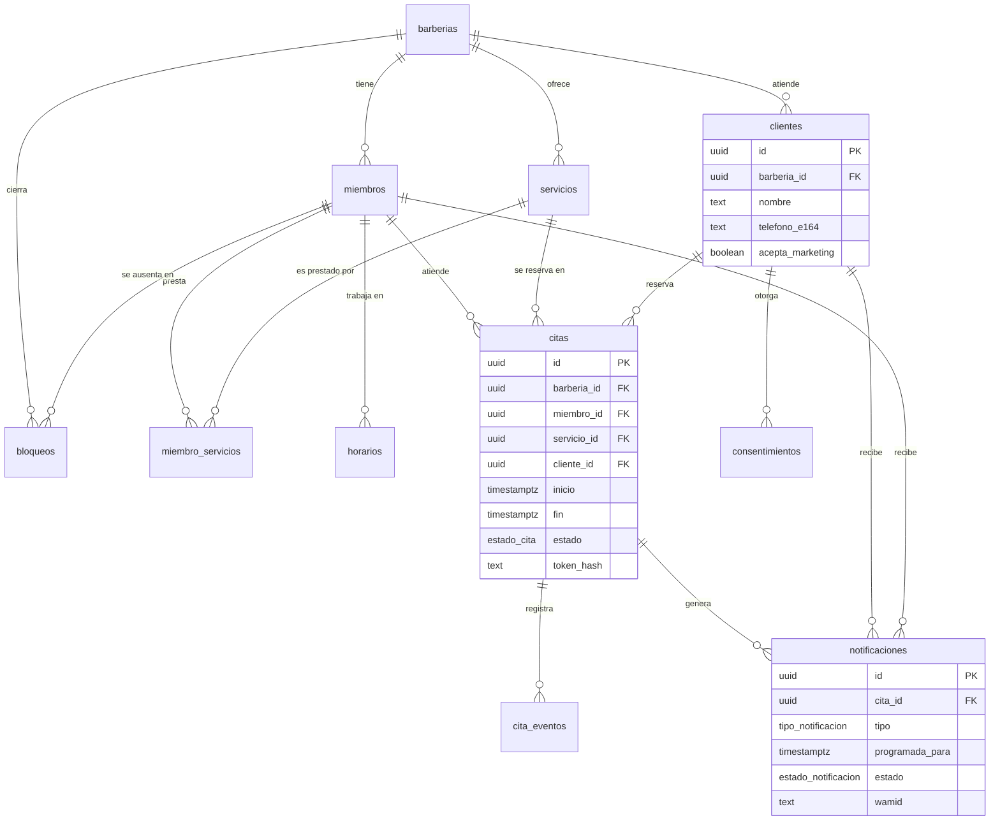

# 04 · Modelo de datos

| | |
|---|---|
| **Versión del documento** | 0.1 (borrador) |
| **Fecha** | 7 de noviembre de 2026 |
| **Motor** | PostgreSQL 15 o superior (propuesto: Supabase) |
| **Documentos relacionados** | [00 · Visión y alcance](00-vision-y-alcance.md), [01 · Requerimientos](01-requerimientos.md) |

---

## 1. Decisiones de diseño

| # | Decisión | Por qué |
|---|---|---|
| DM-01 | Todas las tablas de negocio llevan `barberia_id`. Las relaciones entre tablas usan **llaves foráneas compuestas** `(barberia_id, id)`. | La base de datos impide que una cita de la barbería A apunte a un barbero de la barbería B, aunque el código tenga un error. |
| DM-02 | Llaves primarias `uuid`; tablas de bitácora con `bigint` autoincremental. | Los UUID no revelan cuántos registros hay y se pueden generar en el cliente. |
| DM-03 | Restricción de exclusión `citas_sin_solape` sobre `(miembro_id, rango de tiempo)`. | Cumple RN-02 y RNF-05: dos reservas simultáneas al mismo turno nunca se guardan ambas. |
| DM-04 | La cita guarda una **copia** del nombre, duración y precio del servicio. | RN-13: cambiar un servicio no altera las citas existentes. |
| DM-05 | Del enlace de gestión solo se guarda el **hash** del token. | RNF-10: si se filtra la base, los enlaces siguen siendo secretos. |
| DM-06 | `notificaciones` funciona como bandeja de salida (*outbox*): cada mensaje se programa como una fila y un proceso las envía. | Envío idempotente, reintentos y auditoría (RNF-06, RNF-07). |
| DM-07 | `whatsapp_eventos` funciona como bandeja de entrada (*inbox*) con una clave única de deduplicación. | Meta reintenta los webhooks; un evento repetido no se procesa dos veces. |
| DM-08 | Fechas y horas en `timestamptz` (UTC). Los horarios semanales en `time` local, interpretados con la zona horaria de la barbería. | RNF-12. "Lunes de 9:00 a 13:00" es una hora local, no un instante. |
| DM-09 | No se borran barberos, servicios ni clientes con historial: se desactivan (`activo`) o se anonimizan. | Conservar el historial de citas y cumplir la Ley 1581. |
| DM-10 | Los clientes pertenecen a una barbería; el mismo teléfono en dos barberías son dos registros. | RN-10: aislamiento de datos entre negocios. |
| DM-11 | Todas las tablas tienen RLS activado. El público (anónimo) **nunca** accede a tablas: la página de reserva llama al backend, que usa la llave de servicio en el servidor. | RNF-08. |

---

## 2. Diagrama entidad-relación



`whatsapp_eventos` y `admins_plataforma` no tienen relaciones de negocio y no aparecen en el diagrama.

---

## 3. Tablas

Cada tabla tiene un **dominio dueño**: solo ese dominio escribe en ella ([doc 11](11-dominios.md)).

| Dominio | Tabla | Qué guarda | Requerimientos |
|---|---|---|---|
| barberias | `barberias` | El negocio (tenant): datos públicos y reglas de reserva. | RF-01, RF-32, RF-36, RF-41 |
| barberias | `miembros` | Personal de la barbería (dueño o barbero), vinculado a un usuario de autenticación. | RF-22, RF-34 |
| barberias | `servicios` | Catálogo de servicios con duración y precio. | RF-02, RF-33 |
| barberias | `miembro_servicios` | Qué servicios presta cada barbero (N a N). | RF-03, RF-34 |
| barberias | `admins_plataforma` | Usuarios con acceso de administración del SaaS. | RF-41, RF-42 |
| clientes | `clientes` | Clientes de cada barbería, identificados por teléfono. | RF-05, RF-38, RN-10 |
| clientes | `consentimientos` | Historial de autorizaciones (datos y marketing). Es la prueba ante la Ley 1581. | RF-06, RF-07, RN-12 |
| agenda | `horarios` | Franjas semanales de trabajo de cada barbero. | RF-04, RF-35 |
| agenda | `bloqueos` | Ausencias de un barbero o cierres de toda la barbería. | RF-29, RF-40 |
| agenda | `citas` | Las reservas. Contiene la restricción anti-solape. | RF-05, RF-10 a RF-12, RF-27, RF-28 |
| agenda | `cita_eventos` | Historial de cada cita: creada, confirmada, reagendada, cancelada… | RF-26, RF-27 |
| notificaciones | `notificaciones` | Bandeja de salida de mensajes de WhatsApp y su estado de entrega. | RF-13 a RF-20 |
| mensajeria | `whatsapp_eventos` | Bandeja de entrada del webhook, cruda, para deduplicar y depurar. | RF-16, RF-17 |

---|---|---|
| `barberias` | El negocio (tenant): datos públicos y reglas de reserva. | RF-01, RF-32, RF-36, RF-41 |
| `miembros` | Personal de la barbería (dueño o barbero), vinculado a un usuario de autenticación. | RF-22, RF-34 |
| `servicios` | Catálogo de servicios con duración y precio. | RF-02, RF-33 |
| `miembro_servicios` | Qué servicios presta cada barbero (N a N). | RF-03, RF-34 |
| `horarios` | Franjas semanales de trabajo de cada barbero. | RF-04, RF-35 |
| `bloqueos` | Ausencias de un barbero o cierres de toda la barbería. | RF-29, RF-40 |
| `clientes` | Clientes de cada barbería, identificados por teléfono. | RF-05, RF-38, RN-10 |
| `consentimientos` | Historial de autorizaciones (datos y marketing). Es la prueba ante la Ley 1581. | RF-06, RF-07, RN-12 |
| `citas` | Las reservas. Contiene la restricción anti-solape. | RF-05, RF-10 a RF-12, RF-27, RF-28 |
| `cita_eventos` | Historial de cada cita: creada, confirmada, reagendada, cancelada… | RF-26, RF-27 |
| `notificaciones` | Bandeja de salida de mensajes de WhatsApp y su estado de entrega. | RF-13 a RF-20 |
| `whatsapp_eventos` | Bandeja de entrada del webhook, cruda, para deduplicar y depurar. | RF-16, RF-17 |
| `admins_plataforma` | Usuarios con acceso de administración del SaaS. | RF-41, RF-42 |

---

## 4. Esquema completo (SQL)

Este script es la base de la primera migración (`supabase/migrations/20261107000000_esquema_inicial.sql`). Está pensado para Supabase (usa `auth.users`, `auth.uid()` y los roles `anon`, `authenticated` y `service_role`).

### 4.1 Extensiones y tipos

```sql
create extension if not exists btree_gist;  -- necesaria para las restricciones de exclusión

create type rol_miembro         as enum ('dueno', 'barbero');
create type estado_barberia     as enum ('activa', 'suspendida');
create type estado_cita         as enum ('pendiente', 'confirmada', 'atendida', 'no_asistio', 'cancelada');
create type origen_cita         as enum ('web', 'manual');
create type tipo_actor          as enum ('cliente', 'miembro', 'sistema');
create type tipo_evento_cita    as enum ('creada', 'confirmada', 'reagendada', 'cancelada', 'atendida', 'no_asistio', 'nota');
create type tipo_notificacion   as enum (
  'confirmacion', 'recordatorio_24h', 'recordatorio_2h', 'aviso_cambio',
  'aviso_nueva_reserva', 'aviso_cancelacion', 'aviso_sin_confirmar', 'resumen_diario'
);
create type estado_notificacion as enum ('pendiente', 'enviando', 'enviada', 'entregada', 'leida', 'fallida', 'anulada');
create type tipo_consentimiento as enum ('tratamiento_datos', 'mensajes_marketing');

-- Rango de horas del día, para impedir franjas de horario que se crucen
create type timerange as range (subtype = time);

create or replace function set_updated_at() returns trigger
language plpgsql as $$
begin
  new.updated_at := now();
  return new;
end $$;
```

### 4.2 Tablas

```sql
-- Barberías (tenant) ---------------------------------------------------------
create table barberias (
  id                            uuid primary key default gen_random_uuid(),
  nombre                        text not null,
  slug                          text not null unique check (slug ~ '^[a-z0-9]+(-[a-z0-9]+)*$'),
  direccion                     text not null,
  url_mapa                      text,
  telefono_contacto             text check (telefono_contacto ~ '^\+[1-9][0-9]{7,14}$'),
  logo_url                      text,
  zona_horaria                  text not null default 'America/Bogota',
  estado                        estado_barberia not null default 'activa',
  -- Reglas de reserva (RN-03, RN-04, RN-06, RN-11)
  intervalo_grilla_min          smallint not null default 15 check (intervalo_grilla_min in (5, 10, 15, 20, 30)),
  anticipacion_min_min          integer  not null default 60 check (anticipacion_min_min >= 0),
  ventana_max_dias              smallint not null default 30 check (ventana_max_dias between 1 and 180),
  limite_cancelacion_min        integer  not null default 120 check (limite_cancelacion_min >= 0),
  max_citas_futuras_por_cliente smallint not null default 2 check (max_citas_futuras_por_cliente >= 1),
  created_at                    timestamptz not null default now(),
  updated_at                    timestamptz not null default now()
);

-- Personal: dueños y barberos ------------------------------------------------
create table miembros (
  id                  uuid primary key default gen_random_uuid(),
  barberia_id         uuid not null references barberias (id) on delete cascade,
  user_id             uuid references auth.users (id) on delete set null,  -- null hasta que acepta la invitación
  nombre              text not null,
  email               text,
  telefono_whatsapp   text check (telefono_whatsapp ~ '^\+[1-9][0-9]{7,14}$'),
  rol                 rol_miembro not null default 'barbero',
  atiende             boolean not null default true,   -- aparece como barbero al reservar (un dueño puede no atender)
  activo              boolean not null default true,
  orden               smallint not null default 0,
  recibe_avisos       boolean not null default true,
  hora_resumen_diario time default '07:00',
  created_at          timestamptz not null default now(),
  updated_at          timestamptz not null default now(),
  unique (barberia_id, id),
  unique (barberia_id, user_id)
);

-- Servicios ------------------------------------------------------------------
create table servicios (
  id           uuid primary key default gen_random_uuid(),
  barberia_id  uuid not null references barberias (id) on delete cascade,
  nombre       text not null,
  descripcion  text,
  duracion_min smallint not null check (duracion_min between 5 and 480 and duracion_min % 5 = 0),
  precio_cop   integer  not null check (precio_cop >= 0),
  activo       boolean  not null default true,
  orden        smallint not null default 0,
  created_at   timestamptz not null default now(),
  updated_at   timestamptz not null default now(),
  unique (barberia_id, id)
);

-- Qué servicios presta cada barbero -------------------------------------------
create table miembro_servicios (
  barberia_id uuid not null,
  miembro_id  uuid not null,
  servicio_id uuid not null,
  primary key (miembro_id, servicio_id),
  foreign key (barberia_id, miembro_id)  references miembros  (barberia_id, id) on delete cascade,
  foreign key (barberia_id, servicio_id) references servicios (barberia_id, id) on delete cascade
);

-- Horario semanal (hora local de la barbería) ---------------------------------
create table horarios (
  id          uuid primary key default gen_random_uuid(),
  barberia_id uuid not null,
  miembro_id  uuid not null,
  dia_semana  smallint not null check (dia_semana between 1 and 7),  -- ISO: 1 = lunes … 7 = domingo
  hora_inicio time not null,
  hora_fin    time not null,
  check (hora_fin > hora_inicio),
  foreign key (barberia_id, miembro_id) references miembros (barberia_id, id) on delete cascade,
  -- Dos franjas del mismo barbero y día no pueden cruzarse
  constraint horarios_sin_solape exclude using gist (
    miembro_id with =,
    dia_semana with =,
    timerange(hora_inicio, hora_fin, '[)') with &&
  )
);

-- Bloqueos: ausencias de un barbero o cierre de toda la barbería --------------
create table bloqueos (
  id          uuid primary key default gen_random_uuid(),
  barberia_id uuid not null references barberias (id) on delete cascade,
  miembro_id  uuid,  -- null = aplica a toda la barbería (festivo, cierre)
  inicio      timestamptz not null,
  fin         timestamptz not null,
  motivo      text,
  creado_por  uuid references miembros (id) on delete set null,
  created_at  timestamptz not null default now(),
  check (fin > inicio),
  foreign key (barberia_id, miembro_id) references miembros (barberia_id, id) on delete cascade
);

-- Clientes (por barbería) -----------------------------------------------------
create table clientes (
  id               uuid primary key default gen_random_uuid(),
  barberia_id      uuid not null references barberias (id) on delete cascade,
  nombre           text not null,
  telefono_e164    text check (telefono_e164 ~ '^\+[1-9][0-9]{7,14}$'),  -- null: cita manual sin teléfono, o anonimizado (RN-17)
  acepta_marketing boolean not null default false,  -- estado vigente; el historial está en consentimientos
  notas            text,                            -- notas internas del barbero
  anonimizado_at   timestamptz,                     -- supresión de datos (Ley 1581)
  created_at       timestamptz not null default now(),
  updated_at       timestamptz not null default now(),
  unique (barberia_id, telefono_e164),
  unique (barberia_id, id)
);

-- Consentimientos (prueba de autorización) ------------------------------------
create table consentimientos (
  id            bigint generated always as identity primary key,
  barberia_id   uuid not null,
  cliente_id    uuid not null,
  tipo          tipo_consentimiento not null,
  otorgado      boolean not null,
  version_texto text not null,   -- versión de la política o del texto que aceptó
  origen        origen_cita not null,
  created_at    timestamptz not null default now(),
  foreign key (barberia_id, cliente_id) references clientes (barberia_id, id) on delete cascade
);

-- Citas -----------------------------------------------------------------------
create table citas (
  id                 uuid primary key default gen_random_uuid(),
  barberia_id        uuid not null references barberias (id) on delete cascade,
  miembro_id         uuid not null,
  servicio_id        uuid not null,
  cliente_id         uuid not null,
  inicio             timestamptz not null,
  fin                timestamptz not null,
  estado             estado_cita not null default 'pendiente',
  origen             origen_cita not null default 'web',
  -- Copia del servicio al reservar (RN-13)
  servicio_nombre    text     not null,
  duracion_min       smallint not null,
  precio_cop         integer  not null,
  -- Enlace de gestión: solo el hash SHA-256 del token (RNF-10)
  token_hash         text not null unique,
  confirmada_at      timestamptz,
  cancelada_at       timestamptz,
  cancelada_por      tipo_actor,
  motivo_cancelacion text,
  creada_por         uuid references miembros (id) on delete set null,  -- null si la creó el cliente
  created_at         timestamptz not null default now(),
  updated_at         timestamptz not null default now(),
  check (fin - inicio = make_interval(mins => duracion_min)),
  check ((estado = 'cancelada') = (cancelada_at is not null)),
  foreign key (barberia_id, miembro_id)  references miembros  (barberia_id, id),
  foreign key (barberia_id, servicio_id) references servicios (barberia_id, id),
  foreign key (barberia_id, cliente_id)  references clientes  (barberia_id, id),
  unique (barberia_id, id),
  -- RN-02 / RNF-05: un barbero no puede tener dos citas no canceladas que se crucen
  constraint citas_sin_solape exclude using gist (
    miembro_id with =,
    tstzrange(inicio, fin, '[)') with &&
  ) where (estado <> 'cancelada')
);

-- Historial de cada cita ------------------------------------------------------
create table cita_eventos (
  id          bigint generated always as identity primary key,
  barberia_id uuid not null,
  cita_id     uuid not null,
  tipo        tipo_evento_cita not null,
  actor       tipo_actor not null,
  miembro_id  uuid references miembros (id) on delete set null,
  datos       jsonb not null default '{}'::jsonb,  -- p. ej. {"inicio_anterior": "...", "inicio_nuevo": "..."}
  created_at  timestamptz not null default now(),
  foreign key (barberia_id, cita_id) references citas (barberia_id, id) on delete cascade
);

-- Bandeja de salida de WhatsApp (outbox) --------------------------------------
create table notificaciones (
  id              uuid primary key default gen_random_uuid(),
  barberia_id     uuid not null references barberias (id) on delete cascade,
  cita_id         uuid references citas (id) on delete cascade,  -- null en el resumen diario
  tipo            tipo_notificacion not null,
  cliente_id      uuid references clientes (id) on delete cascade,
  miembro_id      uuid references miembros (id) on delete cascade,
  telefono_e164   text,                    -- copia al programar; null si el cliente se anonimizó
  plantilla       text not null,           -- nombre de la plantilla aprobada en Meta
  idioma          text not null default 'es',
  variables       jsonb not null default '{}'::jsonb,
  programada_para timestamptz not null,
  estado          estado_notificacion not null default 'pendiente',
  intentos        smallint not null default 0,
  wamid           text unique,             -- ID del mensaje que devuelve WhatsApp
  error_codigo    text,
  error_detalle   text,
  enviada_at      timestamptz,
  entregada_at    timestamptz,
  leida_at        timestamptz,
  created_at      timestamptz not null default now(),
  updated_at      timestamptz not null default now(),
  check (num_nonnulls(cliente_id, miembro_id) = 1)  -- va a un cliente o a un miembro, nunca a ambos
);

-- Bandeja de entrada del webhook (inbox) --------------------------------------
create table whatsapp_eventos (
  id            bigint generated always as identity primary key,
  clave_dedupe  text not null unique,  -- id del mensaje entrante, o wamid + ':' + estado
  tipo          text not null check (tipo in ('estado', 'mensaje')),
  wamid         text,
  telefono_e164 text,
  payload       jsonb not null,
  procesado_at  timestamptz,
  error         text,
  recibido_at   timestamptz not null default now()
);

-- Administradores del SaaS ----------------------------------------------------
create table admins_plataforma (
  user_id    uuid primary key references auth.users (id) on delete cascade,
  created_at timestamptz not null default now()
);
```

### 4.3 Índices y triggers

```sql
create index on miembros (user_id);
create index on horarios (miembro_id, dia_semana);
create index on bloqueos (barberia_id, inicio);
create index on citas (barberia_id, inicio);
create index on citas (miembro_id, inicio);
create index on citas (cliente_id, inicio desc);
create index on cita_eventos (cita_id, created_at);
create index on notificaciones (cita_id);

-- Lo que el proceso de envío consulta cada 5 minutos
create index notificaciones_pendientes on notificaciones (programada_para) where estado = 'pendiente';

-- Evita programar dos veces la misma notificación de una cita
create unique index notificaciones_unicas
  on notificaciones (cita_id, tipo, programada_para)
  where cita_id is not null and estado <> 'anulada';

create trigger trg_barberias_updated      before update on barberias      for each row execute function set_updated_at();
create trigger trg_miembros_updated       before update on miembros       for each row execute function set_updated_at();
create trigger trg_servicios_updated      before update on servicios      for each row execute function set_updated_at();
create trigger trg_clientes_updated       before update on clientes       for each row execute function set_updated_at();
create trigger trg_citas_updated          before update on citas          for each row execute function set_updated_at();
create trigger trg_notificaciones_updated before update on notificaciones for each row execute function set_updated_at();
```

### 4.4 Funciones de apoyo para los permisos

Son `security definer` para que la política de `miembros` no se consulte a sí misma en bucle.

```sql
-- ID del miembro activo del usuario actual en una barbería (null si no pertenece)
create or replace function mi_miembro_id(p_barberia uuid) returns uuid
language sql stable security definer set search_path = public as $$
  select id from miembros
  where barberia_id = p_barberia
    and user_id = (select auth.uid())
    and activo
$$;

-- ¿El usuario actual es dueño de esta barbería?
create or replace function es_dueno(p_barberia uuid) returns boolean
language sql stable security definer set search_path = public as $$
  select exists (
    select 1 from miembros
    where barberia_id = p_barberia
      and user_id = (select auth.uid())
      and activo
      and rol = 'dueno'
  )
$$;
```

### 4.5 Seguridad por filas (RLS)

Resumen de permisos para usuarios con sesión (`authenticated`):

| Tabla | Leer | Crear o editar |
|---|---|---|
| `barberias` | Miembros | Dueño (solo editar) |
| `miembros`, `servicios`, `miembro_servicios` | Miembros | Dueño |
| `horarios`, `bloqueos` | Miembros | Dueño, o el barbero sobre lo suyo |
| `clientes`, `consentimientos` | Miembros | Miembros |
| `citas`, `cita_eventos` | Dueño: todas · Barbero: las suyas | Igual que leer |
| `notificaciones` | Dueño: todas · Barbero: las suyas | Solo el backend |
| `whatsapp_eventos`, `admins_plataforma` | Solo el backend | Solo el backend |

El backend usa la llave `service_role`, que salta RLS: **todas sus consultas deben filtrar por `barberia_id`**, y eso se cubre con pruebas.

```sql
alter table barberias         enable row level security;
alter table miembros          enable row level security;
alter table servicios         enable row level security;
alter table miembro_servicios enable row level security;
alter table horarios          enable row level security;
alter table bloqueos          enable row level security;
alter table clientes          enable row level security;
alter table consentimientos   enable row level security;
alter table citas             enable row level security;
alter table cita_eventos      enable row level security;
alter table notificaciones    enable row level security;
alter table whatsapp_eventos  enable row level security;  -- sin políticas: solo service_role
alter table admins_plataforma enable row level security;  -- sin políticas: solo service_role

-- Barberías
create policy "miembros leen su barbería" on barberias
  for select to authenticated using (mi_miembro_id(id) is not null);
create policy "dueño edita su barbería" on barberias
  for update to authenticated using (es_dueno(id)) with check (es_dueno(id));

-- Configuración: todos leen, el dueño administra
create policy "miembros leen" on miembros
  for select to authenticated using (mi_miembro_id(barberia_id) is not null);
create policy "dueño administra" on miembros
  for all to authenticated using (es_dueno(barberia_id)) with check (es_dueno(barberia_id));

create policy "miembros leen" on servicios
  for select to authenticated using (mi_miembro_id(barberia_id) is not null);
create policy "dueño administra" on servicios
  for all to authenticated using (es_dueno(barberia_id)) with check (es_dueno(barberia_id));

create policy "miembros leen" on miembro_servicios
  for select to authenticated using (mi_miembro_id(barberia_id) is not null);
create policy "dueño administra" on miembro_servicios
  for all to authenticated using (es_dueno(barberia_id)) with check (es_dueno(barberia_id));

-- Horarios y bloqueos: el dueño, o el barbero sobre lo suyo
create policy "miembros leen" on horarios
  for select to authenticated using (mi_miembro_id(barberia_id) is not null);
create policy "dueño o titular gestiona" on horarios
  for all to authenticated
  using      (es_dueno(barberia_id) or miembro_id = mi_miembro_id(barberia_id))
  with check (es_dueno(barberia_id) or miembro_id = mi_miembro_id(barberia_id));

create policy "miembros leen" on bloqueos
  for select to authenticated using (mi_miembro_id(barberia_id) is not null);
create policy "dueño o titular gestiona" on bloqueos
  for all to authenticated
  using      (es_dueno(barberia_id) or miembro_id = mi_miembro_id(barberia_id))
  with check (es_dueno(barberia_id) or miembro_id = mi_miembro_id(barberia_id));
  -- un bloqueo de toda la barbería (miembro_id null) solo lo puede crear el dueño

-- Clientes y consentimientos: compartidos por el equipo de la barbería
create policy "miembros leen" on clientes
  for select to authenticated using (mi_miembro_id(barberia_id) is not null);
create policy "miembros crean" on clientes
  for insert to authenticated with check (mi_miembro_id(barberia_id) is not null);
create policy "miembros editan" on clientes
  for update to authenticated
  using (mi_miembro_id(barberia_id) is not null) with check (mi_miembro_id(barberia_id) is not null);

create policy "miembros leen" on consentimientos
  for select to authenticated using (mi_miembro_id(barberia_id) is not null);
create policy "miembros registran" on consentimientos
  for insert to authenticated with check (mi_miembro_id(barberia_id) is not null);

-- Citas: el dueño ve todas, el barbero solo las suyas
create policy "dueño o titular lee" on citas
  for select to authenticated
  using (es_dueno(barberia_id) or miembro_id = mi_miembro_id(barberia_id));
create policy "dueño o titular crea" on citas
  for insert to authenticated
  with check (es_dueno(barberia_id) or miembro_id = mi_miembro_id(barberia_id));
create policy "dueño o titular edita" on citas
  for update to authenticated
  using      (es_dueno(barberia_id) or miembro_id = mi_miembro_id(barberia_id))
  with check (es_dueno(barberia_id) or miembro_id = mi_miembro_id(barberia_id));
-- Sin política de delete: las citas se cancelan, no se borran

create policy "lee eventos de citas visibles" on cita_eventos
  for select to authenticated
  using (exists (select 1 from citas c where c.id = cita_id));  -- la RLS de citas filtra
create policy "registra eventos de citas visibles" on cita_eventos
  for insert to authenticated
  with check (exists (select 1 from citas c where c.id = cita_id));

-- Notificaciones: solo lectura para el personal
create policy "dueño o titular lee" on notificaciones
  for select to authenticated
  using (
    es_dueno(barberia_id)
    or miembro_id = mi_miembro_id(barberia_id)
    or exists (select 1 from citas c where c.id = cita_id)  -- la RLS de citas filtra
  );
```

### 4.6 Vista de resumen de clientes

```sql
-- Dominio dueño: agenda (resume las citas de cada cliente).
-- security_invoker: aplica la RLS de quien consulta.
-- El dueño ve las visitas a toda la barbería; el barbero, las visitas con él.
create view v_clientes_resumen with (security_invoker = true) as
select
  c.id,
  c.barberia_id,
  c.nombre,
  c.telefono_e164,
  count(ci.id) filter (where ci.estado = 'atendida')   as visitas,
  count(ci.id) filter (where ci.estado = 'no_asistio') as inasistencias,
  max(ci.inicio) filter (where ci.estado = 'atendida') as ultima_visita
from clientes c
left join citas ci on ci.cliente_id = c.id
group by c.id;
```

### 4.7 Turnos disponibles (RF-04, RN-02 a RN-04)

Devuelve las horas de inicio libres de un barbero en una fecha, para un servicio de cierta duración. Al reagendar se pasa `p_excluir_cita`, para que la cita no se bloquee a sí misma (mover de 15:00 a 15:15 debe ser posible).

```sql
create or replace function turnos_disponibles(
  p_miembro      uuid,
  p_fecha        date,               -- fecha local de la barbería
  p_duracion_min integer,
  p_excluir_cita uuid default null   -- la cita que se está reagendando
) returns table (inicio timestamptz)
language sql stable security definer set search_path = public as $$
  with barberia as (
    select b.*
    from barberias b
    join miembros m on m.barberia_id = b.id
    where m.id = p_miembro
      and m.activo and m.atiende
      and b.estado = 'activa'
  ),
  franjas as (
    -- Convierte la franja local ("14:00 a 19:00") en instantes reales
    select
      (p_fecha + h.hora_inicio) at time zone b.zona_horaria as desde,
      (p_fecha + h.hora_fin)    at time zone b.zona_horaria as hasta,
      b.id as barberia_id,
      b.intervalo_grilla_min,
      b.anticipacion_min_min,
      b.ventana_max_dias
    from horarios h
    cross join barberia b
    where h.miembro_id = p_miembro
      and h.dia_semana = extract(isodow from p_fecha)
  ),
  candidatos as (
    -- RN-03: un turno cada N minutos, solo si el servicio cabe completo en la franja
    select
      f.barberia_id,
      t as inicio,
      t + make_interval(mins => p_duracion_min) as fin,
      f.anticipacion_min_min,
      f.ventana_max_dias
    from franjas f
    cross join generate_series(
      f.desde,
      f.hasta - make_interval(mins => p_duracion_min),
      make_interval(mins => f.intervalo_grilla_min)
    ) as t
  )
  select c.inicio
  from candidatos c
  where c.inicio >= now() + make_interval(mins => c.anticipacion_min_min)  -- RN-04
    and c.inicio <  now() + make_interval(days => c.ventana_max_dias)
    and not exists (                                                        -- RN-02: citas
      select 1 from citas ci
      where ci.miembro_id = p_miembro
        and ci.estado <> 'cancelada'
        and ci.id is distinct from p_excluir_cita
        and tstzrange(ci.inicio, ci.fin, '[)') && tstzrange(c.inicio, c.fin, '[)')
    )
    and not exists (                                                        -- RN-02: bloqueos
      select 1 from bloqueos bl
      where bl.barberia_id = c.barberia_id
        and (bl.miembro_id = p_miembro or bl.miembro_id is null)
        and tstzrange(bl.inicio, bl.fin, '[)') && tstzrange(c.inicio, c.fin, '[)')
    )
  order by c.inicio
$$;

revoke execute on function turnos_disponibles(uuid, date, integer, uuid) from public, anon;
grant  execute on function turnos_disponibles(uuid, date, integer, uuid) to authenticated, service_role;
```

### 4.8 Anonimización de un cliente (RF-43)

Esta función solo toca tablas del dominio `clientes`. Después de llamarla, el servicio de clientes publica `ClienteAnonimizado` en la misma transacción, y el dominio `notificaciones` borra el teléfono de sus filas y anula las pendientes ([doc 11](11-dominios.md#5-eventos-de-dominio)).

```sql
create or replace function anonimizar_cliente(p_cliente uuid) returns void
language plpgsql security definer set search_path = public as $$
begin
  update clientes
     set nombre = 'Cliente eliminado',
         telefono_e164 = null,
         notas = null,
         acepta_marketing = false,
         anonimizado_at = now()
   where id = p_cliente;
end $$;

revoke execute on function anonimizar_cliente(uuid) from public, anon, authenticated;  -- solo el backend
```

### 4.9 Tiempo real (RF-30)

```sql
alter publication supabase_realtime add table citas;  -- Realtime respeta la RLS de citas
```

---

## 5. Operaciones críticas

### 5.1 Crear una cita desde la página pública

Todo ocurre en **una sola transacción** en el backend:

1. Validar que la barbería esté activa, que el servicio esté activo y que el barbero lo preste (`miembro_servicios`).
2. Validar que la hora pedida esté en `turnos_disponibles(...)` para esa fecha.
3. Normalizar el teléfono a E.164 y hacer *upsert* en `clientes` por `(barberia_id, telefono_e164)`.
4. Validar el máximo de citas futuras del cliente (RN-11).
5. Generar el token (32 bytes aleatorios), guardar su hash SHA-256 en `token_hash` e insertar la cita con la copia del servicio.
6. Insertar en `consentimientos` (tratamiento de datos, y marketing si marcó la casilla) y en `cita_eventos` (`creada`).
7. Insertar las filas de `notificaciones` según RN-07 y los avisos al barbero.
8. Hacer *commit* y devolver el token **en claro una sola vez**, para armar el enlace de gestión.

**Carrera entre dos clientes:** si otro cliente tomó el turno entre el paso 2 y el 5, el `insert` falla con el código `23P01` (`exclusion_violation`) de la restricción `citas_sin_solape`. El backend lo captura y responde "Ese horario se acaba de ocupar" con los turnos actualizados.

### 5.2 Proceso de envío (cron cada 5 minutos)

Toma un lote de notificaciones vencidas sin que dos procesos tomen la misma:

```sql
update notificaciones
   set estado = 'enviando', intentos = intentos + 1
 where id in (
   select id from notificaciones
    where estado = 'pendiente'
      and programada_para <= now()
    order by programada_para
    limit 50
    for update skip locked
 )
returning *;
```

Por cada fila: verifica que la cita siga activa, envía la plantilla, guarda el `wamid` y pasa a `enviada`. Si falla, guarda `error_codigo`; si es un error temporal y `intentos < 3`, vuelve a `pendiente` con `programada_para` unos minutos después; si no, queda `fallida`.

### 5.3 Webhook de WhatsApp

1. Validar la firma `X-Hub-Signature-256` con el App Secret.
2. Insertar el evento crudo y descartar los repetidos:

```sql
insert into whatsapp_eventos (clave_dedupe, tipo, wamid, telefono_e164, payload)
values ($1, $2, $3, $4, $5)
on conflict (clave_dedupe) do nothing
returning id;  -- si no devuelve fila, el evento ya se había recibido
```

3. Responder `200` de inmediato y procesar después:
   - **Estados** (`sent`, `delivered`, `read`, `failed`): actualizar la notificación por `wamid`.
   - **Botones:** el *payload* trae la acción y el ID de la cita (por ejemplo, `CANCELAR:<cita_id>`). Aplicar la transición de RN-08, registrar el evento en `cita_eventos` y programar los avisos al barbero. Si la cita ya no admite el cambio, aplicar RN-15.
4. Marcar `procesado_at`, o guardar `error` para revisarlo.

---

## 6. Retención y privacidad

| Dato | Retención | Cómo |
|---|---|---|
| `whatsapp_eventos` | 90 días | Tarea diaria: `delete from whatsapp_eventos where recibido_at < now() - interval '90 days';` |
| Clientes | Mientras la barbería esté activa o hasta que el cliente pida la supresión | `anonimizar_cliente(id)`: conserva las citas para las estadísticas, sin nombre ni teléfono. |
| `consentimientos` | Mientras exista el cliente | Es la prueba de la autorización ante la Ley 1581. |
| Barbería que se da de baja | Exportar sus datos, luego borrar | El `on delete cascade` desde `barberias` elimina todo lo suyo. |

---

## 7. Pendientes del modelo

- **Festivos de Colombia:** por ahora se cargan como bloqueos de toda la barbería. Evaluar una tabla de festivos nacionales precargada.
- **Datos de prueba:** preparar un `seed.sql` con una barbería, dos barberos, servicios y horarios para desarrollo.
- **Plantillas de WhatsApp:** el nombre exacto de cada plantilla se define en el doc 05 y se referencia en `notificaciones.plantilla`.
- **Reportes (RF-39):** decidir si se calculan con vistas o con una tabla agregada cuando crezca el volumen.
