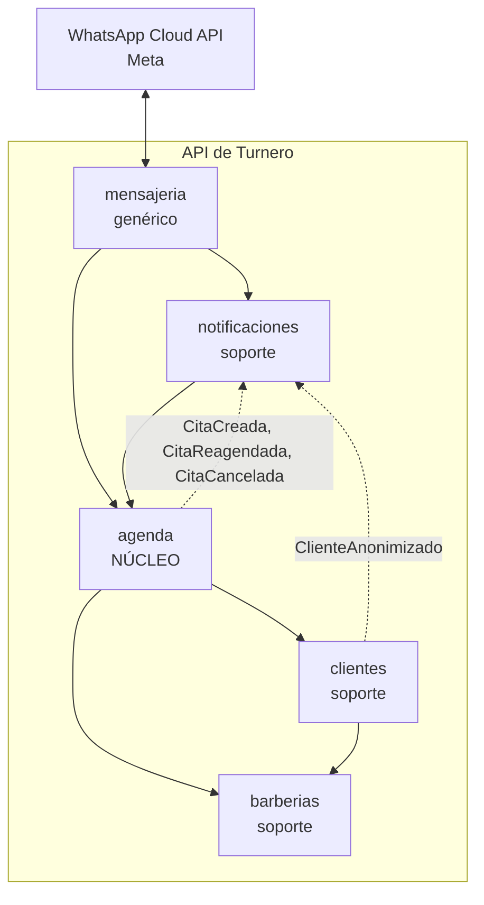
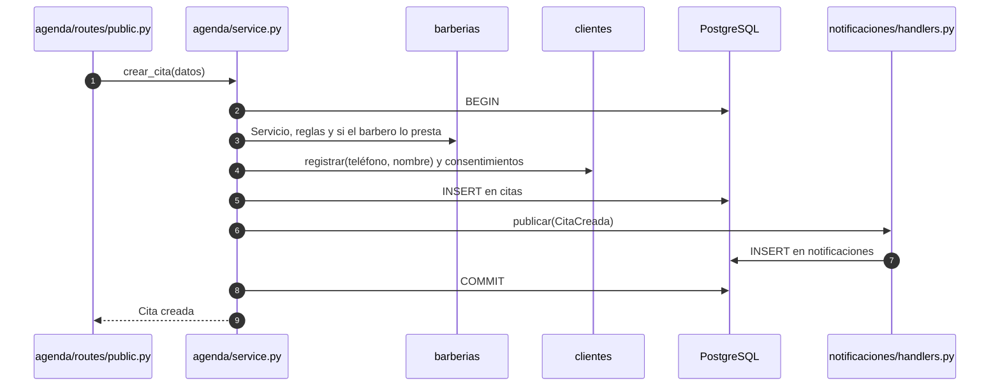

# 11 · Dominios

| | |
|---|---|
| **Versión del documento** | 0.1 (borrador) |
| **Fecha** | 7 de noviembre de 2026 |
| **Documentos relacionados** | [03 · Arquitectura](03-arquitectura.md), [04 · Modelo de datos](04-modelo-de-datos.md), [10 · Estructura del monorepo](10-estructura-del-monorepo.md), [ADR-0009](adr/0009-monolito-modular-por-dominios.md) |

---

## 1. De qué se trata

Organizar el código **por dominios** (o por funcionalidades) significa que las carpetas siguen las partes del negocio (agenda, clientes, notificaciones) y no las capas técnicas (controladores, servicios, repositorios). La idea viene del **diseño guiado por el dominio** (DDD, *Domain-Driven Design*).

### Vocabulario mínimo

| Término | Qué significa aquí |
|---|---|
| **Dominio** | Una parte del negocio con sus propias reglas y datos. Por ejemplo, la agenda. |
| **Subdominio núcleo** | Lo que hace valioso al producto y donde está la ventaja frente a la competencia. Merece el mejor diseño y más pruebas. |
| **Subdominio de soporte** | Necesario para el negocio, pero no es lo que lo diferencia. |
| **Subdominio genérico** | Un problema que ya está resuelto afuera (autenticación, envío de mensajes): se integra, no se inventa. |
| **Contexto delimitado** (*bounded context*) | La frontera dentro de la cual un modelo y sus palabras tienen un solo significado. En este proyecto, cada dominio es un contexto delimitado. |
| **Lenguaje ubicuo** | Usar las mismas palabras en conversaciones, documentos, código y base de datos. Es el glosario del [doc 00](00-vision-y-alcance.md#11-glosario). |
| **Evento de dominio** | Algo que pasó y le interesa a otro dominio: "se creó una cita". |
| **Capa anticorrupción** | Código que traduce el modelo de un sistema externo (Meta) al nuestro, para que sus conceptos no se filtren al resto. |
| **Monolito modular** | Una sola aplicación que se despliega junta, pero con módulos separados por dominio y reglas estrictas de dependencia. |

### Por capas o por dominios

```text
Por capas (lo que NO vamos a hacer)     Por dominios (lo que SÍ)
app/                                    app/domains/
├── routers/                            ├── agenda/
│   ├── citas.py                        │   ├── routes/
│   ├── clientes.py                     │   ├── service.py
│   └── notificaciones.py               │   └── repo.py
├── services/                           ├── clientes/
│   ├── citas.py                        │   ├── routes/
│   └── ...                             │   ├── service.py
└── repositories/                       │   └── repo.py
    └── ...                             └── notificaciones/ …
```

Por dominios, todo lo de la agenda está junto: para cambiar una regla de las citas se abre una sola carpeta, y las dependencias entre partes del negocio se ven y se controlan.

### La decisión

**Monolito modular organizado por dominios** ([ADR-0009](adr/0009-monolito-modular-por-dominios.md)): una sola API y un solo worker, con cinco dominios separados por carpetas y reglas de dependencia verificadas automáticamente en la CI. **No** son microservicios: un desarrollador y un piloto no justifican desplegar y coordinar varios servicios.

---

## 2. Los dominios de Turnero

| Dominio | Tipo | En una frase |
|---|---|---|
| **agenda** | Núcleo | El tiempo de los barberos: horarios, bloqueos, turnos libres y el ciclo de vida de las citas. |
| **barberias** | Soporte | El negocio: datos de la barbería, equipo, roles, servicios y reglas de reserva. |
| **clientes** | Soporte | Quiénes reservan, sus autorizaciones y su derecho a ser olvidados. |
| **notificaciones** | Soporte | Qué mensaje sale, a quién y cuándo, y si llegó. |
| **mensajeria** | Genérico | La integración con WhatsApp: hablar con Meta y traducir lo que responde. |

Además hay dos carpetas que **no son dominios** y no conocen a ninguno:

- **`core/`**: infraestructura técnica (configuración, conexión a la base con contexto RLS, verificación del JWT, bus de eventos, errores, límites, logs).
- **`shared/`**: tipos sin dominio que usan varios (teléfono en E.164, utilidades de zona horaria).

### 2.1 agenda (núcleo)

| | |
|---|---|
| **Responsable de** | Calcular turnos libres; crear, reagendar, confirmar, cancelar y cerrar citas; citas manuales; bloqueos; horarios semanales; agenda del día; resumen de visitas y reportes. |
| **Tablas** | `horarios`, `bloqueos`, `citas`, `cita_eventos` · función `turnos_disponibles()` · vista `v_clientes_resumen` |
| **Casos de uso** | CU-01 a CU-04, CU-07 a CU-10; horarios de CU-11; historial y reportes de CU-12 |
| **Reglas** | RN-01 a RN-06, RN-08, RN-11, RN-13 a RN-15, RN-17, RN-18 |
| **Publica** | `CitaCreada`, `CitaReagendada`, `CitaCancelada` |
| **Depende de** | `barberias` (servicios, reglas, quién presta qué), `clientes` (registrar al cliente al reservar) |

### 2.2 barberias (soporte)

| | |
|---|---|
| **Responsable de** | Datos y estado de la barbería (activa o suspendida); equipo, roles e invitaciones; servicios y quién los presta; reglas de reserva; resolver qué miembro y rol tiene el usuario con sesión; administradores de la plataforma. |
| **Tablas** | `barberias`, `miembros`, `servicios`, `miembro_servicios`, `admins_plataforma` · funciones `mi_miembro_id()`, `es_dueno()` |
| **Casos de uso** | CU-06, CU-11 (salvo horarios), CU-15 |
| **Reglas** | RN-14, RN-16 |
| **Publica** | Nada por ahora |
| **Depende de** | Ningún dominio. Es la base. |

### 2.3 clientes (soporte)

| | |
|---|---|
| **Responsable de** | Registrar o actualizar clientes por teléfono; guardar autorizaciones (datos y marketing); lista y búsqueda; anonimización. |
| **Tablas** | `clientes`, `consentimientos` · función `anonimizar_cliente()` |
| **Casos de uso** | Lista de CU-12, CU-16; el registro del cliente dentro de CU-01 y CU-09 |
| **Reglas** | RN-10, RN-12, RN-17 (autorización) |
| **Publica** | `ClienteAnonimizado` |
| **Depende de** | `barberias` |

### 2.4 notificaciones (soporte)

| | |
|---|---|
| **Responsable de** | Decidir qué notificaciones programar (RN-07, RN-09); la bandeja de salida; el trabajo del worker que las envía; reintentos; estados de entrega; resumen diario; horario silencioso. Define el **puerto** `ProveedorNotificaciones`, pero no sabe que existe WhatsApp. |
| **Tablas** | `notificaciones` |
| **Casos de uso** | CU-13 |
| **Reglas** | RN-07, RN-09 |
| **Escucha** | `CitaCreada`, `CitaReagendada`, `CitaCancelada`, `ClienteAnonimizado` |
| **Depende de** | `agenda`, `clientes`, `barberias` (para leer los datos que van en cada mensaje) |

### 2.5 mensajeria (genérico, capa anticorrupción)

| | |
|---|---|
| **Responsable de** | Llamar a la WhatsApp Cloud API; el catálogo de plantillas; el webhook (firma y deduplicación); traducir los eventos de Meta a acciones de los otros dominios; respuestas automáticas a mensajes libres. Implementa el puerto de notificaciones. |
| **Tablas** | `whatsapp_eventos` |
| **Casos de uso** | CU-05, CU-14 |
| **Reglas** | RN-15 |
| **Depende de** | `notificaciones` (estados de entrega, implementa su puerto), `agenda` (confirmar o cancelar por botón), `clientes`, `barberias` |

---

## 3. Mapa de dominios

Las flechas sólidas son dependencias permitidas (quién importa a quién). Las punteadas son eventos.



Los dominios forman **capas**: cada uno solo puede depender de los que tiene debajo.

```text
mensajeria       ← lo más externo: integración
notificaciones
agenda           ← núcleo
clientes
barberias        ← la base
```

---

## 4. Reglas de frontera

1. **Solo se importa la API pública.** Otro dominio solo usa lo que el dominio expone en su `__init__.py`. Nunca importa su `repo.py` ni sus modelos internos.
2. **Solo hacia abajo.** Un dominio depende únicamente de los que están debajo en el mapa. `agenda` nunca importa `notificaciones`; si necesita que pase algo allá, publica un evento.
3. **Solo el dueño escribe sus tablas.** `agenda` no hace `INSERT` en `clientes`: llama a `clientes.registrar(...)`.
4. **Las lecturas cruzadas viven en `queries.py`.** Para armar una pantalla, un dominio puede leer tablas de los dominios que tiene debajo (por ejemplo, la agenda del día une `citas` con `clientes`), solo en ese archivo y solo para leer.
5. **Los efectos en otros dominios van por eventos**, cuando el dominio que reacciona está arriba del que publica.
6. **`core/` y `shared/` no conocen ningún dominio.**
7. **Las rutas son delgadas.** Traducen HTTP a una llamada al `service` del dominio y nada más.

Las reglas 2 y 6 se verifican solas en la CI (sección 8). Las demás se revisan en cada *pull request*.

---

## 5. Eventos de dominio

| Evento | Lo publica | Lo escucha | Qué hace quien escucha |
|---|---|---|---|
| `CitaCreada` | agenda | notificaciones | Programa la confirmación, los recordatorios y el aviso al barbero (RN-07). |
| `CitaReagendada` | agenda | notificaciones | Anula las pendientes y programa las nuevas, con aviso de cambio al cliente y al barbero. |
| `CitaCancelada` | agenda | notificaciones | Anula las pendientes; avisa al barbero si canceló el cliente, o al cliente si canceló la barbería. |
| `ClienteAnonimizado` | clientes | notificaciones | Borra el teléfono y las variables de sus notificaciones y anula las pendientes. |

**Los eventos se procesan en la misma transacción** que el cambio que los produjo. Si programar las notificaciones falla, la cita tampoco se guarda: nunca queda una cita sin recordatorios. No hace falta una cola de mensajes; la bandeja de salida (`notificaciones`) ya cumple ese papel hacia afuera.

```python
# app/core/eventos.py — bus de eventos en proceso (no conoce ningún dominio)
from collections import defaultdict
from typing import Any, Awaitable, Callable

Manejador = Callable[[Any, Any], Awaitable[None]]  # (conexión, evento)
_manejadores: dict[type, list[Manejador]] = defaultdict(list)


def escuchar(tipo_evento: type):
    def registrar(funcion: Manejador) -> Manejador:
        _manejadores[tipo_evento].append(funcion)
        return funcion
    return registrar


async def publicar(con, evento) -> None:
    """Ejecuta los manejadores dentro de la transacción de quien publica."""
    for manejador in _manejadores[type(evento)]:
        await manejador(con, evento)
```

```python
# app/domains/agenda/events.py
@dataclass(frozen=True)
class CitaCreada:
    cita_id: UUID
    barberia_id: UUID


# app/domains/agenda/service.py
async def crear_cita(con, datos: NuevaCita) -> Cita:
    ...
    await repo.insertar_cita(con, cita)
    await publicar(con, CitaCreada(cita.id, cita.barberia_id))
    return cita


# app/domains/notificaciones/handlers.py  (notificaciones sí puede importar agenda)
@escuchar(agenda.CitaCreada)
async def programar_al_crear(con, evento: agenda.CitaCreada) -> None:
    cita = await agenda.obtener_cita(con, evento.cita_id)
    for nueva in programar(cita, ahora=ahora_utc()):
        await repo.insertar(con, nueva)
```

`main.py` y `worker.py` importan `notificaciones.handlers` al arrancar para registrar los manejadores.

---

## 6. Anatomía de un dominio

Todos los dominios tienen la misma forma. Cada archivo existe solo si el dominio lo necesita.

```text
app/domains/agenda/
├── __init__.py        # API pública: lo único que otros dominios pueden importar
├── models.py          # Entidades y tipos: Cita, EstadoCita, Turno, Horario, Bloqueo
├── rules.py           # Lógica pura, sin base ni red: transiciones (RN-08), grilla (RN-03)…
├── service.py         # Casos de uso con transacción: crear_cita, reagendar, cancelar…
├── repo.py            # SQL de sus propias tablas
├── queries.py         # Lecturas para pantallas, pueden unir tablas de dominios de abajo
├── events.py          # Eventos que publica
├── schemas.py         # Modelos de entrada y salida de la API (Pydantic)
├── routes/
│   ├── public.py      # /public/...
│   └── panel.py       # /panel/...
└── tests/
    ├── test_rules.py  # Rápidas, sin infraestructura
    └── test_service.py
```

| Archivo | Puede importar | No puede |
|---|---|---|
| `rules.py` | `models.py`, `shared/` | Base de datos, red, otros dominios |
| `service.py` | Todo su dominio, `core/`, `shared/`, la API pública de dominios de abajo | El `repo.py` de otro dominio |
| `repo.py`, `queries.py` | `core/db.py`, `models.py` | Lógica de negocio |
| `routes/` | `service.py`, `schemas.py`, `core/auth.py`, `barberias.miembro_actual` | `repo.py` directamente |

Particularidades de cada dominio, además de esa forma base:

- **barberias:** `acceso.py` con `miembro_actual`, la dependencia de FastAPI que usan las rutas del panel de todos los dominios para saber qué miembro y qué rol tiene el usuario.
- **notificaciones:** `ports.py` (el protocolo `ProveedorNotificaciones`), `programador.py` (RN-07 y RN-09 como funciones puras), `handlers.py` (los eventos que escucha), `envio.py` (el trabajo del worker) y `proveedores/consola.py`.
- **mensajeria:** `whatsapp/` (cliente HTTP, firma y plantillas), `proveedor.py` (implementa el puerto de notificaciones), `traductor.py` (la capa anticorrupción) y `routes/webhook.py`.

El árbol completo del repositorio está en el [doc 10](10-estructura-del-monorepo.md).

### En la web

`app/` de Next.js solo define rutas. Los componentes, hooks y llamadas a la API viven en `domains/`, con los mismos nombres que en la API:

```text
apps/web/
├── app/                   # Rutas: cada página arma piezas de los dominios
├── domains/
│   ├── agenda/            # reserva/, gestion/, panel/, horarios/, hooks/, api.ts
│   ├── barberias/         # Ajustes, equipo, servicios, reglas, inicio de sesión
│   ├── clientes/          # Lista e historial
│   └── notificaciones/    # Historial de avisos de una cita
├── components/ui/         # Componentes genéricos, sin dominio
└── lib/                   # Cliente HTTP base, fechas, teléfono, Supabase
```

Regla en la web: un dominio no importa componentes de otro. Si dos dominios necesitan lo mismo, sube a `components/ui/`. La página de `app/` es la que combina piezas de varios dominios.

### En la base de datos

Todas las tablas viven en el esquema `public` (así lo espera Supabase), pero cada una tiene un dominio dueño, indicado en el [doc 04](04-modelo-de-datos.md#3-tablas). Las migraciones llevan el dominio en el nombre: `20261120093000_agenda_agregar_notas_a_citas.sql`.

---

## 7. Ejemplo: reservar una cita atraviesa tres dominios



`agenda` nunca menciona a `notificaciones`: solo publica el evento. Si mañana se agrega un dominio de fidelización que también escuche `CitaCreada`, la agenda no cambia.

---

## 8. Verificación automática de los límites

En la API, **import-linter** revisa en cada *pull request* que nadie rompa el orden de las capas. Va en `apps/api/pyproject.toml` y se ejecuta con `uv run lint-imports` (incluido en `make lint`):

```toml
[tool.importlinter]
root_package = "app"

[[tool.importlinter.contracts]]
name = "Los dominios solo dependen de los que tienen debajo"
type = "layers"
layers = [
  "app.domains.mensajeria",
  "app.domains.notificaciones",
  "app.domains.agenda",
  "app.domains.clientes",
  "app.domains.barberias",
]

[[tool.importlinter.contracts]]
name = "core y shared no conocen los dominios"
type = "forbidden"
source_modules = ["app.core", "app.shared"]
forbidden_modules = ["app.domains"]
```

Probado sobre un esqueleto de esta estructura: la versión correcta pasa, y si `agenda` importa `notificaciones` la verificación falla indicando el archivo y la línea.

En la web, la regla `no-restricted-imports` de ESLint (o el plugin `eslint-plugin-boundaries`) impide que un dominio importe componentes de otro.

---

## 9. Dónde quedó cada cosa

Equivalencias con los módulos que se nombraban en versiones anteriores del doc 03.

| Antes | Ahora |
|---|---|
| `modules/reservas` | `domains/agenda` (rutas públicas y `service.crear_cita`) |
| `modules/gestion_cliente` | `domains/agenda` (rutas públicas con token) |
| `modules/panel` | `domains/agenda` (rutas del panel) |
| `modules/configuracion` | `domains/barberias`; los horarios, en `domains/agenda` |
| `modules/clientes` | `domains/clientes`; el historial y los reportes, en `domains/agenda/queries.py` |
| `modules/notificaciones` | `domains/notificaciones`; `WhatsAppCloudProvider`, en `domains/mensajeria` |
| `modules/whatsapp` | `domains/mensajeria` |
| `modules/admin` | Repartido: barberías en `barberias/routes/admin.py`, supresión en `clientes/routes/admin.py`, registro de envíos en `notificaciones` |
| `domain/estados.py` | `domains/agenda/rules.py` |
| `domain/telefonos.py`, `domain/tiempo.py` | `shared/telefono.py`, `shared/tiempo.py` |
